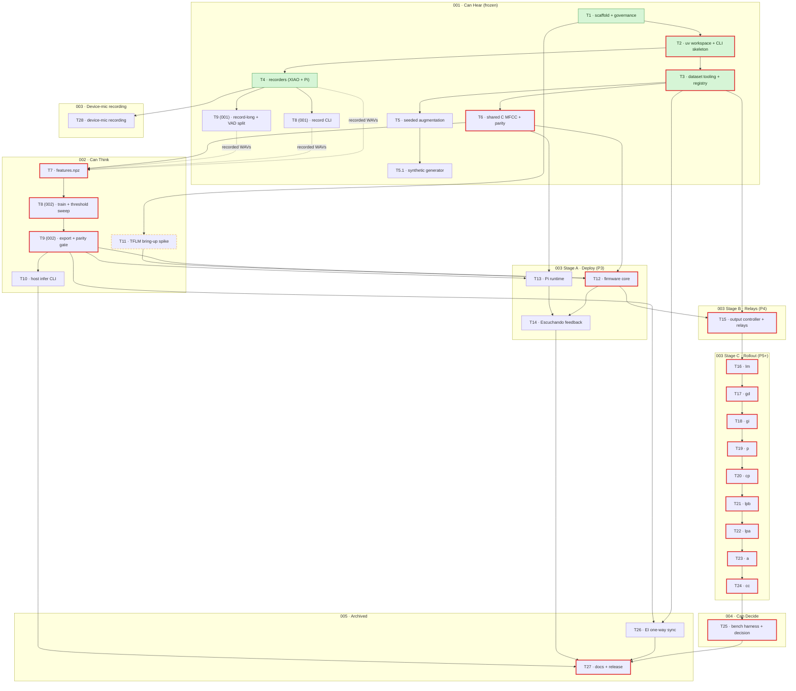

# Critical Path — all milestones

> Governance doc. The **source of truth for dependencies is each spec's `tasks.md`**; this graph,
> the critical path, and the numbers below are derived from them (2026-11-17). Diagrams are
> Mermaid (steering conventions). Per-spec graphs (only that spec's tasks) live in each `tasks.md`
> under "Critical path (within this spec)"; this doc is the cross-spec view. Status note: specs
> 002–005 are still `requirements:draft` — their task graphs are drafts, so the path is provisional
> until each `tasks:approved`. Spec 001 is `tasks:approved` and **frozen** (not modified by the
> 2026-11-17 ID work); T1–T4 are complete.

## Dependency graph (T1 → T27, all specs)

Solid arrows = declared task dependencies. Dotted arrows = real-world **data** preconditions not
declared as task deps (documented in the notes). Red outline = critical path; green = complete;
orange dashed = spike.

Spec 001 is frozen, so its `T8`/`T9` share IDs with spec 002's `T8`/`T9`; in this graph (and in
cross-spec references) they are qualified as `T8 (001)` / `T9 (002)` etc.

## Critical path (declared dependencies, longest chain)

**T2 → T3 → T6 → T7 → T8 (002) → T9 (002) → T12 → T15 → T16 … T24 → T25 → T27**

| Step | Task | Est. | Status |
|---|---|---|---|
| 1 | T2 — uv workspace + CLI skeleton | 2 h | ✅ done |
| 2 | T3 — dataset tooling + registry | 3 h | ✅ done |
| 3 | T6 — shared C MFCC + parity | 4 h | pending |
| 4 | T7 — features.npz | 2 h | pending |
| 5 | T8 (002) — train + threshold sweep | 4 h | pending |
| 6 | T9 (002) — export + parity gate | 4 h | pending |
| 7 | T12 — firmware core | 3 h | pending |
| 8 | T15 — output controller + relays | 4 h | pending |
| 9 | T16–T24 — per-command rollout (9 × 2.5 h) | 22.5 h | pending |
| 10 | T25 — bench harness + decision | 3 h | pending |
| 11 | T27 — docs + release | 2 h | pending |
| | **Total** | **≈ 53.5 h** | ≈ 5 h done → **≈ 48.5 h remaining** |

## Notes

1. **Rollout dominates the path** (~42% of 53.5 h). The 9 cycles are sequential by policy, not
   by dependency: recording command N+1 can overlap the training/export of command N. That
   overlap is the main lever for shortening the path.
2. **T8/T9 ID duplication (001 vs 002) — accepted; spec 001 is frozen.** Spec 001's late-added
   recorder tasks (`T8` record CLI, `T9` record-long + VAD split) share IDs with spec 002's `T8`
   (training) and `T9` (export). Spec 001 is `tasks:approved` and is not modified; references to
   these IDs are spec-qualified (`T8 (001)` vs `T8 (002)`) wherever ambiguity matters. New task
   IDs use plain integers; decimals are reserved for spec 001's existing `T5.1`.
3. **Data collection is a real precondition** not declared as a task dep: T7 consumes recorded
   WAVs (from T4 recorders, `T8 (001)`/`T9 (001)` CLIs, or owner `ext` recordings), while its
   declared dep is only T6. These are the dotted edges — schedule them against wall-clock, not
   just the graph.
4. **Spike T11** runs in parallel from T1 (2 h). Its outcome gates TD-004 (firmware approach)
   and the **ESP32 path is gated on it**: T12 (and therefore T15) depends on T11 (TFLM spike)
   plus the model artifacts from T9 (002). The Pi path (T13) depends on T6 + T9 (002) but not
   T11.
5. **Stage gates:** if Stage A exit (incl. T14 at ≈24 h) is enforced before Stage B starts, add
   ≈2 h of serialization over the pure data-dependency path.
6. **Off the critical path** (parallel capacity): T13 (5 h), T14 (2 h), T10 (3 h), T26 (2 h),
   T28 (2 h), T5/T5.1 (5 h). T28 (device-mic recording, US-002) runs once the hardware is live
   and feeds later rollout retrains. T26's EI project setup can be done any time after T3.
