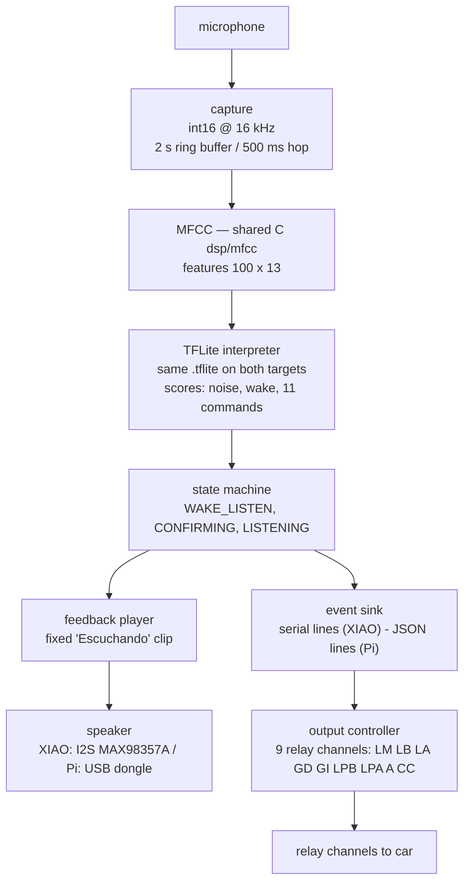
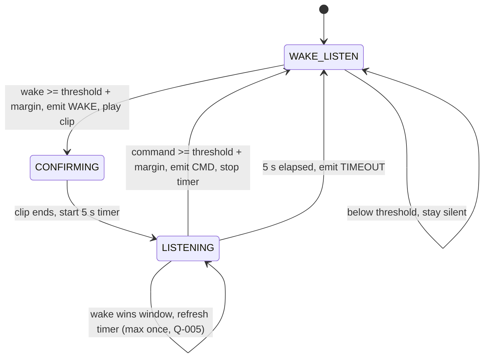

# Design — 001 Ultron Car Manager

## Executive summary

One PyTorch keyword-spotting model (13 classes: `wake`, `noise`, and 11 command classes
`lm lb la gd gi p cp lpb lpa a cc`) exported once to TFLite (int8 MCU / float16-or-int8 Pi)
drives an identical two-stage state machine (wake → "Escuchando" playback → 5 s command window →
event/timeout) plus an
output controller with 9 relay channels (LM LB LA GD GI LPB LPA A CC) on both a XIAO ESP32S3
Sense and an Orange Pi Zero 2W; a shared C MFCC library guarantees train-vs-device feature
parity, and a benchmark protocol selects the shipping device.

## Requirements mapping

| FR / NFR | Design section |
|---|---|
| FR-001, FR-002, FR-004, FR-006 | [State machine](#state-machine) |
| FR-003, FR-015 | [Model](#model) (thresholds & margins), [State machine](#state-machine) |
| FR-005, D-004 | [State machine](#state-machine) (wake class ignored in LISTENING) |
| FR-007 | [Architecture](#architecture) (on-device only) |
| FR-008 | [Event contract](#event-contract) |
| FR-009, NFR-009 | [Output controller](#output-controller) |
| FR-010, FR-011 | [Export pipeline](#export-pipeline), NFR-007 check |
| FR-012 | [EI sync](#ei-sync-one-way-archive) |
| FR-013, D-005 | [Data model](#data-model) (registry.json) |
| FR-017 | [Output controller](#output-controller) (CP cancel) |
| FR-014 | [Benchmark protocol](#benchmark-protocol) |
| FR-016 | [Data model](#data-model) (registry cap) |
| FR-018, FR-019, NFR-010 | [Audio feedback](#audio-feedback), [State machine](#state-machine) |
| NFR-001, NFR-002 | [Technical decisions](#technical-decisions) TD-006, [Memory budget](#memory-budget) |
| NFR-003, NFR-005 | [Data model](#data-model), [Verification strategy](#verification-strategy) |
| NFR-006 | [Conventions](../../../.ai/steering/conventions.md) (seeds, changelog) |
| NFR-007 | [DSP parity](#dsp-parity), [Export pipeline](#export-pipeline) |
| NFR-008 | [Observability](#observability) |

## Architecture

Both targets implement the same component graph; only the boxes' implementations differ:



### State machine

States: `WAKE_LISTEN`, `CONFIRMING`, `LISTENING`. One multiclass model runs continuously; the
state machine interprets its scores (D-004):



| Current | Trigger | Action | Next |
|---|---|---|---|
| WAKE_LISTEN | wake ≥ wake_threshold + margin | emit `WAKE`, play "Escuchando" (FR-018) | CONFIRMING |
| WAKE_LISTEN | any other score / below threshold | stay silent | WAKE_LISTEN |
| CONFIRMING | playback ends (≤ 500 ms, NFR-010) | start 5 s timer; discard windows overlapping playback | LISTENING |
| LISTENING | command ≥ cmd_threshold[class] + margin[class], argmax ≠ wake | emit `CMD id conf`, stop timer | WAKE_LISTEN |
| LISTENING | wake wins its window | refresh timer (max once, Q-005) | LISTENING |
| LISTENING | 5 s elapsed | emit `TIMEOUT` | WAKE_LISTEN |

Debounce: while LISTENING, a `WAKE` argmax never acts as a command (FR-005). While CONFIRMING, no
window decides — frames overlapping playback are excluded (FR-019); inference and `DBG pred=`
logging continue. The model itself is
stateless; all state is the machine above (identical semantics on both targets — AGENTS rule 5).

## Audio feedback

Wake acceptance is confirmed by playing the fixed clip `assets/escuchando.wav` (FR-018, FR-019,
D-006, Q-012): rendered once with a Spanish TTS voice, 16 kHz/16-bit/mono, ≤ 500 ms
(silence-trimmed), committed to the repo — byte-identical on both targets. No runtime synthesis
exists on any target.

- **Trigger**: the `WAKE_LISTEN → CONFIRMING` transition — the same edge that emits `WAKE`.
- **Timing**: playback starts ≤ 200 ms after acceptance, ends ≤ 500 ms after it starts; the 5 s
  command timer starts at playback end (NFR-010) — the whole chain stays inside FR-001's budget.
- **Self-hearing guard**: classification windows whose frames overlap playback are discarded
  (FR-019); inference and `DBG pred=` logging continue throughout.
- **Observability**: playback logs `DBG play=escuchando state=start|end t_ms=…` (NFR-008 style).
- **Fail-fast**: an absent/unusable output device aborts at boot with
  `EVT ERROR code=SPK_INIT_FAILED` on both targets (Q-003 precedent).

| Target | Output path | Playback |
|---|---|---|
| XIAO | MAX98357A I2S DAC/amp → 8 Ω speaker; I2S on free header pins (SD-card pins stay free for relays, TD-009) | WAV streamed from flash via I2S |
| Pi | USB audio dongle → powered speaker (default ALSA device) | same clip via `sounddevice` output stream |

Flash cost on XIAO: ~16 KB (500 ms of 16 kHz int16 mono) — fits NFR-002 alongside the model.

## Data model

```
dataset/                          # gitignored
  originals/<label>/*.wav         # {label}_{nn}.wav — real recordings (16k/16-bit/mono)
  augmented/<label>/aug_*.wav     # 4 seeded ffmpeg variants per original
  holdout/<label>/*.wav           # fresh recordings, NEVER trained on (NFR-003)
build/features.npz                  # float32 features + labels + file paths (cache)
```

`model/registry.json` (versioned; D-005) — owner-resolved registry (Q-001):

```json
{
  "version": 2,
  "language": "es",
  "wake":   { "id": "wake", "phrase": ["hey ultron"] },
  "noise":  { "id": "noise" },
  "commands": [
    { "id": "lm",  "sigla": "LM",  "phrase": ["luz media", "enciende luz media"],                       "behavior": "steady",             "channels": ["lm"] },
    { "id": "lb",  "sigla": "LB",  "phrase": ["luz baja", "enciende luz baja"],                         "behavior": "steady",             "channels": ["lb", "lm"] },
    { "id": "la",  "sigla": "LA",  "phrase": ["luz alta", "enciende luz alta"],                         "behavior": "steady",             "channels": ["la", "lb", "lm"] },
    { "id": "gd",  "sigla": "GD",  "phrase": ["guiñador derecho", "enciende guiñador derecho"],         "behavior": "blink_45s",          "channels": ["gd"] },
    { "id": "gi",  "sigla": "GI",  "phrase": ["guiñador izquierdo", "enciende guiñador izquierdo"],     "behavior": "blink_45s",          "channels": ["gi"] },
    { "id": "p",   "sigla": "P",   "phrase": ["parqueo", "enciende parqueo"],                           "behavior": "blink_until_cancel", "channels": ["gd", "gi"] },
    { "id": "cp",  "sigla": "CP",  "phrase": ["cancelar parqueo"],                                      "behavior": "cancel",             "channels": [] },
    { "id": "lpb", "sigla": "LPB", "phrase": ["limpia parabrisas baja", "enciende limpia parabrisas baja"], "behavior": "motor",          "channels": ["lpb"] },
    { "id": "lpa", "sigla": "LPA", "phrase": ["limpia parabrisas alta", "enciende limpia parabrisas alta"], "behavior": "motor",          "channels": ["lpa"] },
    { "id": "a",   "sigla": "A",   "phrase": ["arranque", "enciende arranque"],                         "behavior": "pulse_2s",           "channels": ["a"] },
    { "id": "cc",  "sigla": "CC",  "phrase": ["cierre centralizado", "enciende cierre centralizado"],   "behavior": "pulse_05s",          "channels": ["cc"] }
  ],
  "cap": { "actions": 10, "model_classes": 13 }
}
```

`model/thresholds.json` (versioned; Q-006): `{"wake": 0.80, "margin_wake": 0.10,
"commands": {"lm": {"threshold": 0.80, "margin": 0.10}, "…": "…"}, "window_s": 5.0}` — one entry
per command class.

Label set = sorted registry ids (`lm lb la gd gi p cp lpb lpa a cc`) + `wake` + `noise`; class
index order is frozen into the export and the device firmware (same array order everywhere).
Phrase variants share one class per command (TD-010).

## DSP

`dsp/mfcc.{h,c}` — the only MFCC implementation in the repo (principle 2), compiled three ways:

1. **Firmware**: compiled directly into `devices/esp32/ultron_voice/`.
2. **Pi runtime**: built as a shared library, loaded via `ctypes` (`devices/orangepi/`).
3. **Training**: built on the host, invoked by `ultron features` (numpy wrapper) — training
   features come from the same bytes (lampara-aliz lesson, elevated to a principle).

Parameters (ported from the Edge Impulse MFCC proven in lampara-aliz): 16 kHz, int16 input,
frame 20 ms / stride 20 ms, 13 MFCC coefficients, **2.0 s analysis window → (100 × 13)**, computed
every 500 ms hop. Analysis-window length is 2 s because 3–4-word Spanish phrases do not fit 1 s
(TD-006).

**DSP parity**: `ultron features` also emits reference vectors; `tests/test_dsp_parity.py`
compares per-frame outputs against the lampara-aliz EI reference extraction (max abs diff ≤ 1e-3,
NFR-007).

## Model

PyTorch (`model/model.py`) — input `(100, 13)`, restricted op set (Q-008):

```
Conv1d(13 → 16, k=3, relu) → MaxPool1d(2)
Conv1d(16 → 32, k=3, relu) → GlobalAvgPool1d
Linear(32 → 16, relu) → Linear(16 → C, softmax)     # C = 13 (wake, noise, 11 commands)
```

Training (`model/train.py`): Adam 1e-3, sparse categorical cross-entropy, class weights for
imbalance, batch 16, early stopping (patience 30), stratified 90/10 split seeded 42, up to 300
epochs. Fresh hold-out is scored after training and reported separately (NFR-003).

Threshold sweep (`ultron train sweep`): grid over threshold ∈ {0.6…0.95} × margin ∈ {0.05…0.20}
against the hold-out, writing `model/thresholds.json` (Q-006) with the operator-chosen operating
point.

## Export pipeline

`model/export.py` + `ultron export tflite` (FR-010):

1. `torch.onnx.export` (opset ~17) → `build/model.onnx`
2. `onnx2tf` → float TFLite (TensorFlow is a build-time-only dependency)
3. Quantize: **full-int8** (`TFLITE_BUILTINS_INT8`, int8 in/out) with training features as the
   representative dataset → `build/model_int8.tflite` (XIAO)
4. **float16** → `build/model_fp16.tflite` (Pi); int8 also offered for the Pi
5. **Parity report** (`build/parity_report.md`): PyTorch vs int8 argmax agreement on the val
   split — must be ≥ 99% or the export **fails** (FR-011, NFR-007)
6. Label order echoed into the report and into `build/labels.json`

## Event contract

Identical event types/semantics on both targets (FR-008):

| Event | XIAO serial line (115200-8N1) | Pi JSON line |
|---|---|---|
| Wake | `EVT WAKE conf=0.94 t_ms=12345` | `{"event":"wake","conf":0.94,"t_ms":12345}` |
| Command | `EVT CMD id=gd conf=0.91 t_ms=12900` | `{"event":"cmd","id":"gd","conf":0.91,"t_ms":12900}` |
| Timeout | `EVT TIMEOUT t_ms=16000` | `{"event":"timeout","t_ms":16000}` |
| Error | `EVT ERROR code=MIC_INIT_FAILED` | `{"event":"error","code":"mic_init_failed"}` |

`t_ms` = milliseconds since boot. Debug prediction lines (NFR-008): `DBG pred=noise conf=0.77 …`.
Actuators/hosts parse only `EVT` lines / `event` fields — never debug lines.

## Output controller

Consumes `CMD` events and drives **9 relay channels** (`lm lb la gd gi lpb lpa a cc`) per the
requirements' Actuation Behavior Contract. Same behavior-engine semantics on both targets
(AGENTS rule 5); only the GPIO layer differs.

| Behavior (registry enum) | Engine |
|---|---|
| `steady` | latch channels ON; a luz command replaces the luz state (off / lm / lb / la) |
| `blink_45s` | 1.0 s ON / 1.0 s OFF cycle for exactly 45 s, then OFF |
| `blink_until_cancel` | GD+GI blink in phase until a CP event |
| `cancel` (CP) | stop parqueo blinking, GD/GI OFF; no-op if parqueo inactive (FR-017) |
| `motor` | latch motor channel ON; LPB/LPA mutually exclusive (Q-011 default) |
| `pulse_2s` / `pulse_05s` | hold channel exactly 2 s / 0.5 s (±50 ms), then OFF |

Priority rules: GD or GI while parqueo is active → parqueo cancels and the single-side 45 s
blink starts; parqueo while a single blink is active → overrides into hazard. All channels OFF
at boot and after reset (NFR-009). Timing via a 50 ms non-blocking tick — classification never
pauses for outputs.

### Relay hardware (9 channels)

- **XIAO**: header GPIOs driving a relay board (5 V modules, VCC on 5 V; open-drain driving as
  proven on lampara-aliz D7). The final firmware needs no SD card, so `wav_recorder`'s SD pins
  are free — header allocation fits 9 channels; if it comes up short, add an **I2C PCF8574
  expander** (TD-009 fallback).
- **Orange Pi**: `libgpiod` on the 26-pin header + 3.3 V relay board (Q-010 resolved — Pi
  actuation is in scope because the bench decides the winner).

## EI sync (one-way archive)

`ultron ei sync` (FR-012, Should): uploads `dataset/originals/**` with labels, `registry.json`
(label metadata), and the current `model_int8.tflite` to the EI project from `.env` (Q-009).
Post-sync checksum comparison proves local files untouched; the command refuses to ever *download
or overwrite* local artifacts (AGENTS rule 3).

## Memory budget (XIAO)

| Item | Budget | Estimated actual | Confirmed by |
|---|---|---|---|
| int8 model (flash) | ≤ 100 KB | ~6 KB (≈3K params: 13-class head adds only ~160 B vs 3-class) | T9 (export size report) |
| "Escuchando" clip (flash) | — | ~16 KB (500 ms, 16 kHz int16 mono) | T15 playback verified |
| TFLM arena | ≤ 150 KB | ~16–32 KB | T10b (arena stats) |
| Audio ring buffer (2 s int16 @16 kHz) | 64 KB | 64 KB | — |
| MFCC work area | ≤ 8 KB | ~8 KB | T6 |
| **Total RAM (inference path)** | **≤ 240 KB** | **~95–110 KB** of 512 KB internal SRAM | T10b/T12 logs |

Estimates are arithmetic from the design architecture; the "Confirmed by" column turns them into
measured facts before tasks complete. Splitting into two models would *increase* RAM (two arenas)
— size is a reason to keep the single model (TD-001), not to split.

## Benchmark protocol

Scripted, sequential (Q-004), per device (FR-014, US-005):

1. **Latency**: 20 wake utterances → measure end-of-utterance → `WAKE` (via `t_ms` deltas +
   operator timestamping protocol in `docs/bench.md`).
2. **Accuracy**: each command × 10 live utterances → confusion matrix from event log.
3. **False accepts**: 30 min ambient listening → count false `WAKE` (target ≤ 1) and false `CMD`
   (target 0) (NFR-004).
4. **Memory**: reported arena/heap stats from device logs (NFR-002).
5. **Output timing**: relay channels probed during scripted commands — blink period 2.0 s
   ±200 ms, GD/GI span 45 s ±1 s, A pulse 2 s ±50 ms, CC pulse 0.5 s ±50 ms, CP stop < 200 ms
   (FR-009); feedback: "Escuchando" starts ≤ 200 ms after `WAKE` and ends ≤ 500 ms later
   (NFR-010).
6. Results table + device decision in `docs/bench.md`.

## Technical decisions

**TD-001 — Single multiclass model + firmware state machine** (D-004). Alternatives: two
dedicated models (wake-net with hard negatives + command-net) — better precision at the cost of
two artifacts and 2× inference; rejected for v1 simplicity, revisit if NFR-004 fails.

**TD-002 — Conversion via `torch.onnx.export` → onnx2tf → TFLite.** Alternatives: re-author
training in TensorFlow like lampara-aliz (rejected: TensorFlow-first contradicts the project
goal); torchscript/executorch (rejected: less mature int8 full-quant MCU story). TensorFlow stays
a build-time-only dependency of onnx2tf.

**TD-003 — Shared C MFCC library** (principle 2). Alternatives: librosa/numpy-only features
(rejected: train/serve divergence risk — exactly what bit TinyML projects); TFLM built-in audio
frontend (rejected: MFCC not fully exposed in the Arduino library path).

**TD-004 — XIAO runs TFLite-Micro from the Arduino/ESP32 ecosystem** (e.g. `TensorFlowLite_ESP32`
library or vendored `esp-tflite-micro`; spike T10a decides). Alternatives: reusing the EI library
shell as runtime (rejected: EI is export-only); ESP-IDF rewrite (rejected: abandons the proven
arduino-cli workflow for no inference benefit). `AllOpsResolver` keeps the flatbuffer portable.

**TD-005 — Pi runtime: Python `tflite_runtime` + `sounddevice` + ctypes DSP.** Alternatives:
C++ runtime on the Pi (rejected: no benefit at 200 ms budget, kills iteration speed); full
TensorFlow (fallback only if the aarch64 interpreter wheel is unavailable).

**TD-006 — 2.0 s analysis window / 500 ms hop** (vs lampara-aliz's 1 s). Reason: 3–4-word Spanish
commands ("enciende guiñador izquierdo") exceed 1 s; wake utterance (~1 s) sits comfortably inside
a 2 s window. Cost: 2× features per window, still trivially small.

**TD-007 — arduino-cli + esp32 Arduino core, same as lampara-aliz.** Alternative: PlatformIO or
ESP-IDF (rejected: toolchain churn with zero model benefit).

**TD-008 — Events over USB serial (XIAO) / stdout JSON lines (Pi)**; actuation local. Alternatives:
MQTT/WiFi control plane (rejected: v1 non-goal, keep the device isolated).

**TD-009 — 9 relay channels on header GPIOs; I2C PCF8574 expander as fallback.** Reason: the
final firmware needs no SD card, freeing `wav_recorder`'s pins; the expander is the documented
escape hatch if allocation comes up short. Alternatives: dedicated automotive shield (none
exists for XIAO), direct high-side drivers (deferred — the bench rig uses relays).

**TD-010 — Phrase variants merge into one class per command.** Reason: 13 classes keeps the
model tiny; variants differ mainly by the leading verb, and class weights + augmentation absorb
the diversity. Alternative: one class per variant (21 classes) — more precision but more data
per variant and a larger model; revisit only if the bench shows variant-induced confusion.

**TD-011 — Pre-rendered TTS clip for wake confirmation** (D-006, FR-018). Alternatives: runtime
TTS on the Pi (rejected: the XIAO cannot synthesize speech → divergent behavior = bug, AGENTS
rule 5); owner-recorded clip (deferred: extra recording session, zero functional gain — the
asset is a single file and can be swapped without code changes); buzzer beep (rejected: owner
asked for spoken "Escuchando").

## Risks & mitigations

- **PDM vs USB mic domain shift** → record training data from both mics; bench measures
  per-device accuracy; augmentation adds robustness.
- **Arduino TFLM library gap** → spike T10a in phase P3 timeline, before firmware work is
  committed; documented fallback: vendor `esp-tflite-micro` component.
- **onnx2tf conversion gap** → op set restricted (Q-008); smoke-test export on a randomly
  initialized model early (task T9 depends on T8 which is late — mitigated by a throwaway
  conversion smoke test inside T9's first checklist item).
- **int8 softmax saturation** (outputs quantize to 1/255 steps, confident predictions cap at
  0.996) → known lampara-aliz finding; margins tuned on quantized outputs, not float ones.
- **Self-hearing** (feedback clip reaching the mic): `CONFIRMING` discards windows overlapping
  playback (FR-019); the bench protocol includes wake → command sequences with the speaker live.

## Verification strategy

| Level | What | How |
|---|---|---|
| Unit | DSP parity | `tests/test_dsp_parity.py` vs EI reference vectors (≤ 1e-3/frame) |
| Unit | Reproducibility | same seed ⇒ identical split hashes + metrics |
| Unit | Registry/thresholds | schema validation tests |
| Integration | Export | parity report ≥ 99% (FR-011); labels.json order check |
| Integration | CLI | `ultron dataset validate` exit codes on corrupt/valid fixtures |
| On-device | Interaction script | US-001 AC1–AC3 executed on both devices via event log |
| On-device | Output timing | relay probes: blink/pulse durations within FR-009 tolerances |
| On-device | Audio feedback | WAKE → clip timing on both devices: start ≤ 200 ms, duration ≤ 500 ms (NFR-010) |
| On-device | Benchmark | protocol above → `docs/bench.md` |
| Acceptance | EI sync | sync → checksum compare → EI project shows dataset + model |

## Observability

Every inference window logs a `DBG pred=… conf=…` line and every channel change a
`DBG out=<id> state=on|off t_ms=…` line (NFR-008); events use the contract above. The bench
harness parses event + output logs into the metrics table — no manual transcription.
