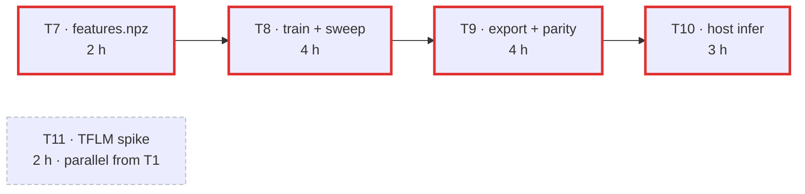

# Tasks — 002 Can Think (Milestone 2)

## Requirement coverage

| Requirement | Tasks |
|---|---|
| FR-010, FR-011 | T9 |
| FR-013, FR-015 | T8 |
| FR-032, FR-033 | T8 |
| FR-034, FR-035, FR-036 | T10 |
| FR-003 (thresholds input — runtime emission is spec 003) | T8 |
| NFR-003, NFR-005 (variant counts) | T8 |
| NFR-006 | T8 |
| NFR-007 (export clause) | T9 |
| US-003 | T7, T8, T9 |
| US-008 | T8, T9 |
| US-009 | T10 |
| US-004 (artifact-parity clause; deployment is spec 003) | T9 |

This spec **is** Milestone 2 (can think) — see [.ai/sdd/PLAN.md](../../PLAN.md). Training starts
from the initial 4-class set (`wake`, `noise`, `la`, `lb` — TD-012); the remaining commands land
one record → train → validate → export cycle at a time via spec 003's Stage C tasks (T16–T24).
Depends on spec 001 (dataset, registry, MFCC library). T11 is the firmware spike — it runs here,
early and parallel, because its outcome gates Milestone 3 planning.

## Implementation readiness check

- [ ] `.status` reads `requirements:approved` (currently `requirements:draft`)
- [ ] `.status` reads `design:approved`
- [ ] `.status` reads `tasks:approved` — **gates all implementation work**
- [ ] Spec 001 (can-hear) delivers: validated dataset, `registry.json`, MFCC library (T3/T6)
- [ ] No open questions remain in requirements.md (none today — Q-002/Q-006/Q-008/Q-013 resolved)

Implementation must be executed in dependency order; each task is verified by its own acceptance
criteria before the next begins. Spikes (T11) never mark other tasks complete.

## Critical path (within this spec)

Only spec-002 tasks are shown. Entry dependencies (from spec 001): validated dataset +
`registry.json` + shared C MFCC (T3/T6) and recorded WAVs.

**Critical path: T7 → T8 → T9 → T10 (2 + 4 + 4 + 3 = 13 h).** T11 is a 2 h spike scheduled in
parallel from T1 — off the path, but its outcome gates spec 003's firmware approach.

## Tasks

### T7 — Feature extraction → feature archive (2 h)
- Covers: US-003, NFR-006. Deps: spec 001 T6 (MFCC library). Priority: Must.
- **"npz"** = a NumPy archive file — one compressed file holding several arrays together. Here it
  packages the whole training set: the float32 MFCC feature matrix, each row's label, and the
  source file path, so PyTorch can load it in one step.
- Checklist: `ultron features` builds `build/features.npz` (float32 features + labels +
  paths) via the C library; NaN check fails loudly (FR-022, spec 001); split hash recorded.
- Likely files: `cli/src/ultron/features.py`, `tests/test_features.py`.
- Verify: `uv run ultron features` succeeds on fixture set; re-run ⇒ identical file hash.

### T8 — PyTorch training + threshold sweep (4 h)
- Covers: FR-003 (input), FR-013, FR-015, FR-032, FR-033, NFR-003, NFR-006. Deps: T7,
  **Q-001 resolved** (it is — registry per spec 001). Priority: Must.
- Checklist: `model/model.py` (design architecture, dynamic C), `model/train.py` (seeded split,
  class weights, early stop), class set derived from archive labels — `wake` + `noise` + ≥ 1
  command, initial `la` + `lb`, minimum-set guard failing with the missing labels named
  (FR-032/033, TD-012), phrase variants share one class per command (TD-010) with per-variant
  counts validated (NFR-005, spec 001), synthetic clips mixed in only via `--with-synthetic`
  (spec 001 T5.1, default off), fresh hold-out scoring, `ultron train run` + `train sweep`
  writing `model/thresholds.json` (trained commands only); PR description records dataset
  counts + versions + seed.
- Likely files: `model/model.py`, `model/train.py`, `cli/src/ultron/train.py`,
  `model/thresholds.json`, `tests/test_train_smoke.py`.
- Verify: 2-epoch smoke run on 4-class fixtures completes; hold-out report generated; seed rerun
  ⇒ same split hash and metrics; a fixture missing `noise` fails naming the label (FR-033).

### T9 — Export: ONNX → TFLite + parity gate (4 h)
- Covers: FR-010, FR-011, NFR-007 (export clause), NFR-002 (size report). Deps: T8. Priority:
  Must.
- Checklist: first item is a conversion smoke test on a randomly initialized model (risk
  mitigation); `ultron export tflite` (onnx → onnx2tf → int8 full-quant + float16), representative
  dataset from features, parity report ≥ 99% else fail, `build/labels.json` order check; sizes
  reported vs NFR-002 budget (spec 003).
- Likely files: `model/export.py`, `cli/src/ultron/export.py`, `tests/test_export_smoke.py`.
- Verify: `uv run ultron export tflite` produces `model_int8.tflite`, `model_fp16.tflite`,
  `parity_report.md` with agreement ≥ 99%; deliberately corrupted-parity fixture fails the gate.

### T10 — Host inference: `ultron infer` (3 h)
- Covers: FR-034, FR-035, FR-036, US-009. Deps: T9. Priority: Must.
- Checklist: `ultron infer files` — WAV/folder scoring via the shared C MFCC binding (2 s windows,
  500 ms hop), scores + decoded detection through `model/thresholds.json`, runnable on **both**
  `model_int8.tflite` and `model_fp16.tflite`; batch agreement report host-TFLite vs PyTorch on
  labeled folders (FR-036); `ultron infer mic` — continuous host-mic scoring with wake → command
  decisions within `window_s` (no actuation, no spec 003 event semantics).
- Likely files: `cli/src/ultron/infer.py`, `tests/test_infer.py`.
- Verify: `uv run ultron infer files --model build/model_int8.tflite --wav <fixture folder>`
  prints scores + detections and emits the agreement report; a deliberately corrupted artifact
  fails loudly; `infer mic` demo logged.

### T11 — TFLM bring-up spike (2 h, labeled SPIKE)
- Deps: T1 (runs early, parallel to T8). Outcome gates spec 003's firmware approach (TD-004).
- Checklist: install candidate TFLM Arduino library (TD-004); run a canned sine-model inference
  on XIAO; measure arena + inference time; write findings to `docs/spike_tflm.md`.
- Verify: spike doc exists with go/no-go on TD-004 and measured numbers.

## Traceability note

Every task maps to requirements in the coverage table; any FR without a task is a spec gap —
stop and update the spec (never silently implement).
