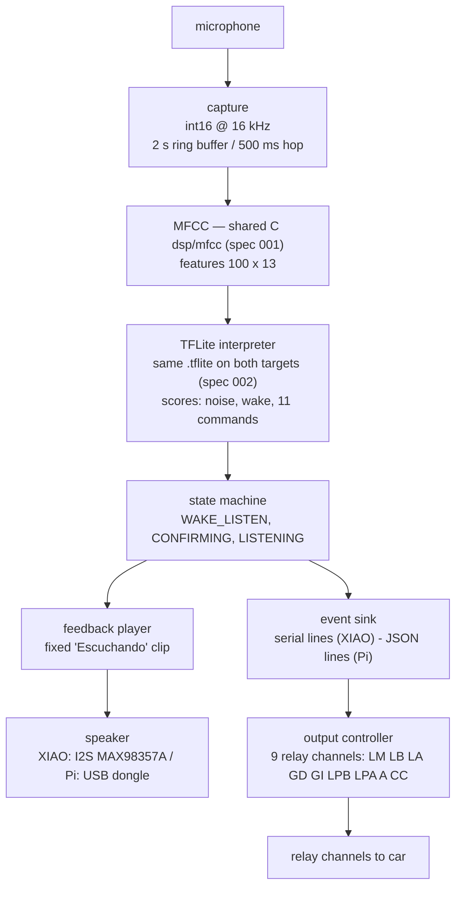
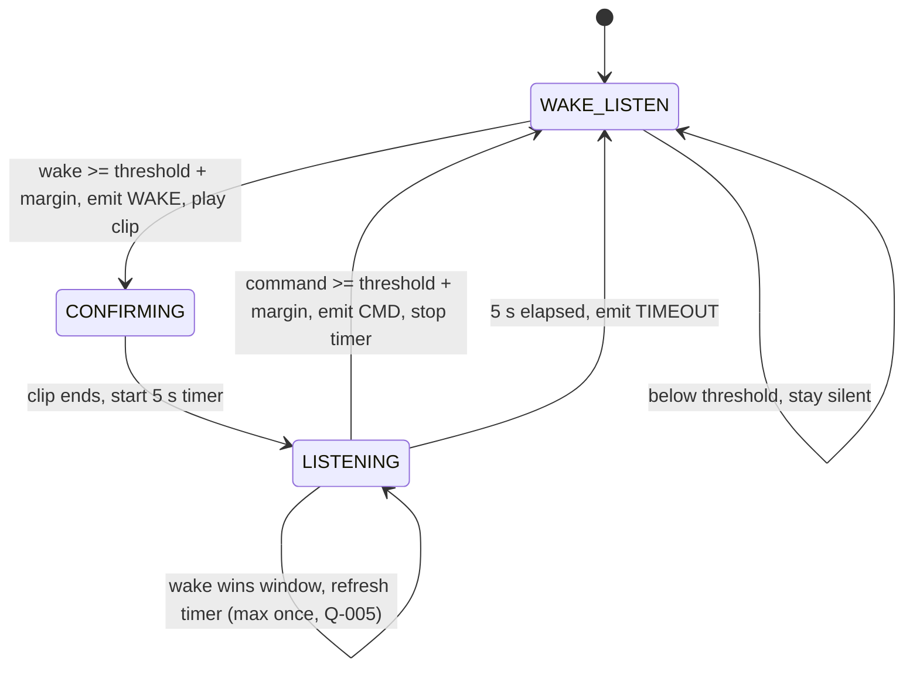

# Design — 003 Can Act (Milestone 3)

## Executive summary

Both targets run the same component graph — capture → shared C MFCC (spec 001) → TFLite
interpreter (artifacts from spec 002) → a three-state machine (`WAKE_LISTEN`, `CONFIRMING`,
`LISTENING`) → event sink + feedback player + output controller with 9 relay channels — with only
the box implementations differing: Arduino/ESP32 C++ firmware on the XIAO, Python (`tflite_runtime`
+ `sounddevice` + libgpiod) on the Pi. Identical semantics are an AGENTS rule 5 invariant.

## Requirements mapping

| FR / NFR | Design section |
|---|---|
| FR-001, FR-002, FR-004, FR-005, FR-006 | [State machine](#state-machine) |
| FR-003, FR-015 | [State machine](#state-machine) (thresholds from spec 002) |
| FR-007 | [Architecture](#architecture) (on-device only) |
| FR-008 | [Event contract](#event-contract) |
| FR-009, FR-017, NFR-009 | [Output controller](#output-controller) |
| FR-018, FR-019, NFR-010 | [Audio feedback](#audio-feedback), [State machine](#state-machine) |
| NFR-001, NFR-002 | TD-004/TD-006, [Memory budget](#memory-budget) |
| NFR-008 | [Observability](#observability) |

## Architecture

### State machine

States: `WAKE_LISTEN`, `CONFIRMING`, `LISTENING`. One multiclass model runs continuously; the
state machine interprets its scores (D-004, spec 002):

| Current | Trigger | Action | Next |
|---|---|---|---|
| WAKE_LISTEN | wake ≥ wake_threshold + margin | emit `WAKE`, play "Escuchando" (FR-018) | CONFIRMING |
| WAKE_LISTEN | any other score / below threshold | stay silent | WAKE_LISTEN |
| CONFIRMING | playback ends (≤ 500 ms, NFR-010) | start 5 s timer; discard windows overlapping playback | LISTENING |
| LISTENING | command ≥ cmd_threshold[class] + margin[class], argmax ≠ wake | emit `CMD id conf`, stop timer | WAKE_LISTEN |
| LISTENING | wake wins its window | refresh timer (max once, Q-005) | LISTENING |
| LISTENING | 5 s elapsed | emit `TIMEOUT` | WAKE_LISTEN |

Debounce: while LISTENING, a `WAKE` argmax never acts as a command (FR-005). While CONFIRMING, no
window decides — frames overlapping playback are excluded (FR-019); inference and `DBG pred=`
logging continue. The model itself is stateless; all state is the machine above (identical
semantics on both targets — AGENTS rule 5).

## Audio feedback

Wake acceptance is confirmed by playing the fixed clip `assets/escuchando.wav` (FR-018, FR-019,
D-006, Q-012): rendered once with a Spanish TTS voice, 16 kHz/16-bit/mono, ≤ 500 ms
(silence-trimmed), committed to the repo — byte-identical on both targets. No runtime synthesis
exists on any target.

- **Trigger**: the `WAKE_LISTEN → CONFIRMING` transition — the same edge that emits `WAKE`.
- **Timing**: playback starts ≤ 200 ms after acceptance, ends ≤ 500 ms after it starts; the 5 s
  command timer starts at playback end (NFR-010) — the whole chain stays inside FR-001's budget.
- **Self-hearing guard**: classification windows whose frames overlap playback are discarded
  (FR-019); inference and `DBG pred=` logging continue throughout.
- **Observability**: playback logs `DBG play=escuchando state=start|end t_ms=…` (NFR-008 style).
- **Fail-fast**: an absent/unusable output device aborts at boot with
  `EVT ERROR code=SPK_INIT_FAILED` on both targets (Q-003 precedent from spec 001).

| Target | Output path | Playback |
|---|---|---|
| XIAO | MAX98357A I2S DAC/amp → 8 Ω speaker; I2S on free header pins (SD-card pins stay free for relays, TD-009) | WAV streamed from flash via I2S |
| Pi | USB audio dongle → powered speaker (default ALSA device) | same clip via `sounddevice` output stream |

Flash cost on XIAO: ~16 KB (500 ms of 16 kHz int16 mono) — fits NFR-002 alongside the model.

## Event contract

Identical event types/semantics on both targets (FR-008):

| Event | XIAO serial line (115200-8N1) | Pi JSON line |
|---|---|---|
| Wake | `EVT WAKE conf=0.94 t_ms=12345` | `{"event":"wake","conf":0.94,"t_ms":12345}` |
| Command | `EVT CMD id=gd conf=0.91 t_ms=12900` | `{"event":"cmd","id":"gd","conf":0.91,"t_ms":12900}` |
| Timeout | `EVT TIMEOUT t_ms=16000` | `{"event":"timeout","t_ms":16000}` |
| Error | `EVT ERROR code=MIC_INIT_FAILED` | `{"event":"error","code":"mic_init_failed"}` |

`t_ms` = milliseconds since boot. Debug prediction lines (NFR-008): `DBG pred=noise conf=0.77 …`.
Actuators/hosts (and the spec 004 bench) parse only `EVT` lines / `event` fields — never debug
lines.

## Output controller

Consumes `CMD` events and drives **9 relay channels** (`lm lb la gd gi lpb lpa a cc`) per the
Actuation Behavior Contract (requirements). Same behavior-engine semantics on both targets
(AGENTS rule 5); only the GPIO layer differs.

| Behavior (registry enum) | Engine |
|---|---|
| `steady` | latch channels ON; a luz command replaces the luz state (off / lm / lb / la) |
| `blink_45s` | 1.0 s ON / 1.0 s OFF cycle for exactly 45 s, then OFF |
| `blink_until_cancel` | GD+GI blink in phase until a CP event |
| `cancel` (CP) | stop parqueo blinking, GD/GI OFF; no-op if parqueo inactive (FR-017) |
| `motor` | latch motor channel ON; LPB/LPA mutually exclusive (Q-011 default) |
| `pulse_2s` / `pulse_05s` | hold channel exactly 2 s / 0.5 s (±50 ms), then OFF |

Priority rules: GD or GI while parqueo is active → parqueo cancels and the single-side 45 s
blink starts; parqueo while a single blink is active → overrides into hazard. All channels OFF
at boot and after reset (NFR-009). Timing via a 50 ms non-blocking tick — classification never
pauses for outputs.

### Relay hardware (9 channels)

- **XIAO**: header GPIOs driving a relay board (5 V modules, VCC on 5 V; open-drain driving as
  proven on lampara-aliz D7). The final firmware needs no SD card, so `wav_recorder`'s SD pins
  are free — header allocation fits 9 channels; if it comes up short, add an **I2C PCF8574
  expander** (TD-009 fallback).
- **Orange Pi**: `libgpiod` on the 26-pin header + 3.3 V relay board (Q-010 resolved — Pi
  actuation is in scope because the bench decides the winner).

## Memory budget (XIAO)

| Item | Budget | Estimated actual | Confirmed by |
|---|---|---|---|
| int8 model (flash) | ≤ 100 KB | ~6 KB (≈3K params: 13-class head adds only ~160 B vs 3-class) | spec 002 T9 (export size report) |
| "Escuchando" clip (flash) | — | ~16 KB (500 ms, 16 kHz int16 mono) | T15 playback verified |
| TFLM arena | ≤ 150 KB | ~16–32 KB | T10b (arena stats) |
| Audio ring buffer (2 s int16 @16 kHz) | 64 KB | 64 KB | — |
| MFCC work area | ≤ 8 KB | ~8 KB | spec 001 T6 |
| **Total RAM (inference path)** | **≤ 240 KB** | **~95–110 KB** of 512 KB internal SRAM | T10b/T12 logs |

Estimates are arithmetic from the design architecture; the "Confirmed by" column turns them into
measured facts before tasks complete. Splitting into two models would *increase* RAM (two arenas)
— size is a reason to keep the single model (TD-001, spec 002), not to split.

## Technical decisions

**TD-004 — XIAO runs TFLite-Micro from the Arduino/ESP32 ecosystem** (e.g. `TensorFlowLite_ESP32`
library or vendored `esp-tflite-micro`; spike T10a, spec 002, decides). Alternatives: reusing the
EI library shell as runtime (rejected: EI is export-only); ESP-IDF rewrite (rejected: abandons
the proven arduino-cli workflow for no inference benefit). `AllOpsResolver` keeps the flatbuffer
portable.

**TD-005 — Pi runtime: Python `tflite_runtime` + `sounddevice` + ctypes DSP.** Alternatives:
C++ runtime on the Pi (rejected: no benefit at 200 ms budget, kills iteration speed); full
TensorFlow (fallback only if the aarch64 interpreter wheel is unavailable).

**TD-007 — arduino-cli + esp32 Arduino core, same as lampara-aliz.** Alternative: PlatformIO or
ESP-IDF (rejected: toolchain churn with zero model benefit).

**TD-008 — Events over USB serial (XIAO) / stdout JSON lines (Pi)**; actuation local. Alternatives:
MQTT/WiFi control plane (rejected: v1 non-goal, keep the device isolated).

**TD-009 — 9 relay channels on header GPIOs; I2C PCF8574 expander as fallback.** Reason: the
final firmware needs no SD card, freeing `wav_recorder`'s pins; the expander is the documented
escape hatch if allocation comes up short. Alternatives: dedicated automotive shield (none
exists for XIAO), direct high-side drivers (deferred — the bench rig uses relays).

**TD-011 — Pre-rendered TTS clip for wake confirmation** (D-006, FR-018). Alternatives: runtime
TTS on the Pi (rejected: the XIAO cannot synthesize speech → divergent behavior = bug, AGENTS
rule 5); owner-recorded clip (deferred: extra recording session, zero functional gain — the
asset is a single file and can be swapped without code changes); buzzer beep (rejected: owner
asked for spoken "Escuchando").

## Verification strategy

| Level | What | How |
|---|---|---|
| On-device | Interaction script | US-001 AC1–AC3 executed on both devices via event log |
| On-device | Output timing | relay probes: blink/pulse durations within FR-009 tolerances |
| On-device | Audio feedback | WAKE → clip timing on both devices: start ≤ 200 ms, duration ≤ 500 ms (NFR-010) |
| On-device | Boot safety | all channels OFF at boot/reset (NFR-009); `SPK_INIT_FAILED` on missing output |
| On-device | Inference latency | ≤ 400 ms XIAO / ≤ 200 ms Pi logged (NFR-001) |

## Observability

Every inference window logs a `DBG pred=… conf=…` line and every channel change a
`DBG out=<id> state=on|off t_ms=…` line (NFR-008); events use the contract above. The bench
(spec 004) parses event + output logs into the metrics table — no manual transcription.
