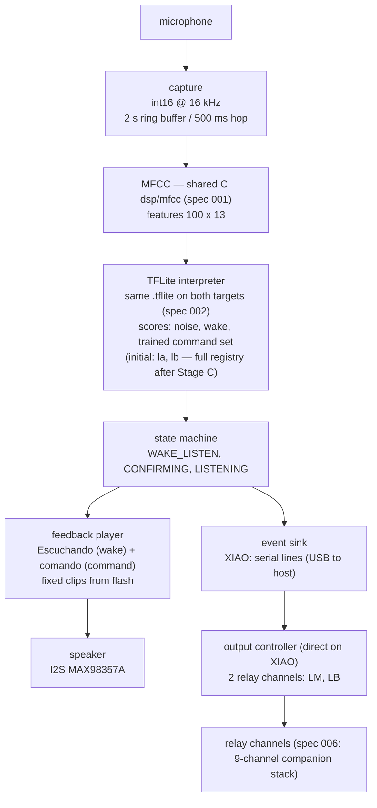
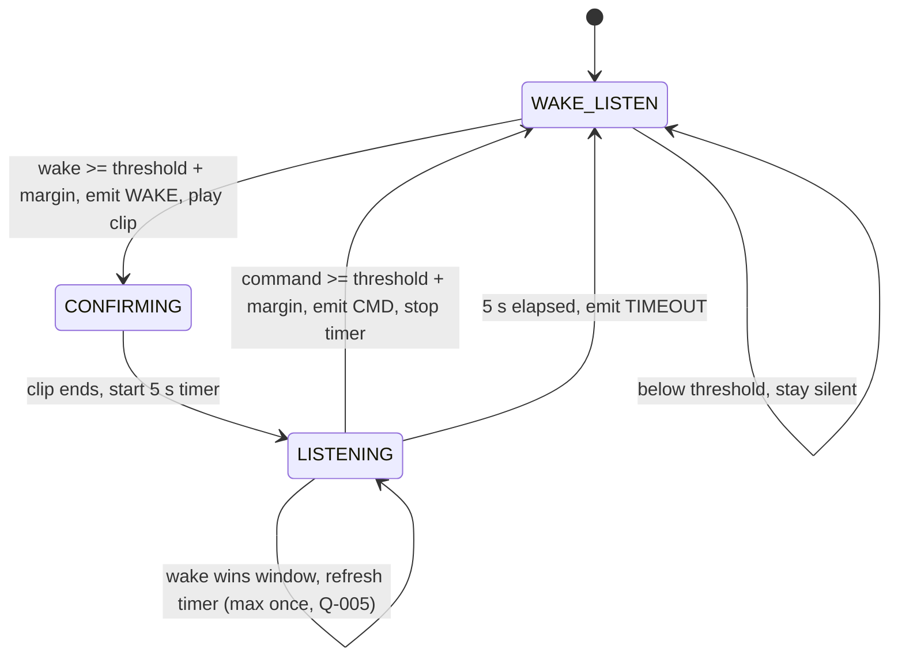

# Design — 003 Can Act (Milestone 3)

> **Scope amendment (owner decision, 2026-11-26): the Orange Pi Zero 2W is removed from the
> project.** Single target only (XIAO ESP32S3 Sense); Pi runtime, recorder and the
> cross-target benchmark are deleted (specs 004/005, `devices/orangepi/`, fp16 export).
> Pi clauses below are historical; IDs are preserved, never renumbered.

## Executive summary

The XIAO ESP32S3 runs Arduino/ESP32 C++ firmware: capture → shared C MFCC (spec 001) → TFLite
interpreter (artifacts from spec 002) → a three-state machine (`WAKE_LISTEN`, `CONFIRMING`,
`LISTENING`) → event sink (USB serial) + feedback player (wake "Escuchando" + command "comando"
clips) → **2 relay channels driven directly from XIAO pins** (LM, LB — the minimal model's
commands are `la`, `lb`). Bring-up is staged: console-only (T12) → audio feedback + 2 direct
relays (T14, T15). **Scope decisions (owner, 2026-11-21):** the companion ESP32-S3 SuperMini
9-channel stack (FR-038, TD-012) and the per-command rollout live in spec 006-can-act-full; the
Orange Pi runtime (TD-005) and cross-target parity are **withdrawn** (owner, 2026-11-26). Identical
event semantics remain the contract — AGENTS rule 5 invariant.

## Requirements mapping

| FR / NFR | Design section |
|---|---|
| FR-001, FR-002, FR-004, FR-005, FR-006 | [State machine](#state-machine) |
| FR-003, FR-015 | [State machine](#state-machine) (thresholds from spec 002) |
| FR-007 | [Architecture](#architecture) (on-device only) |
| FR-008 | [Event contract](#event-contract) |
| FR-009, FR-017, NFR-009 | [Output controller](#output-controller) (2 direct channels; spec 006: 9-channel stack) |
| FR-018, FR-019, FR-037, NFR-010 | [Audio feedback](#audio-feedback), [State machine](#state-machine) |
| FR-038 | *(moved to spec 006-can-act-full — companion stack deferred, owner 2026-11-21)* |
| NFR-001, NFR-002 | TD-004/TD-006, [Memory budget](#memory-budget) |
| NFR-008 | [Observability](#observability) |

## Architecture



### State machine

States: `WAKE_LISTEN`, `CONFIRMING`, `LISTENING`. One multiclass model runs continuously; the
state machine interprets its scores (D-004, spec 002):



| Current | Trigger | Action | Next |
|---|---|---|---|
| WAKE_LISTEN | wake ≥ wake_threshold + margin | emit `WAKE`, play "Escuchando" (FR-018) | CONFIRMING |
| WAKE_LISTEN | any other score / below threshold | stay silent | WAKE_LISTEN |
| CONFIRMING | playback ends (≤ 500 ms, NFR-010) | start 5 s timer; discard windows overlapping playback | LISTENING |
| LISTENING | command ≥ cmd_threshold[class] + margin[class], argmax ≠ wake | emit `CMD id conf`, stop timer, play "comando" clip (FR-037) | WAKE_LISTEN |
| LISTENING | wake wins its window | refresh timer (max once, Q-005) | LISTENING |
| LISTENING | 5 s elapsed | emit `TIMEOUT` | WAKE_LISTEN |

Debounce: while LISTENING, a `WAKE` argmax never acts as a command (FR-005). While CONFIRMING —
and during "comando" playback after a command — no window decides: frames overlapping any
playback are excluded (FR-019, FR-037); inference and `DBG pred=` logging continue. The model
itself is stateless; all state is the machine above (identical semantics on both targets —
AGENTS rule 5).

## Audio feedback

Wake acceptance is confirmed by playing the fixed clip `assets/escuchando.wav` (FR-018, FR-019,
D-006, Q-012): rendered once with a Spanish TTS voice, 16 kHz/16-bit/mono, ≤ 500 ms
(silence-trimmed), committed to the repo — byte-identical on both targets. Executed commands are
confirmed by the fixed clip `assets/comando.wav` (FR-037): rendered once (Spanish TTS word or
short tone), 16 kHz/16-bit/mono, ≤ 300 ms, committed to the repo. No runtime synthesis exists on
any target.

- **Trigger (wake)**: the `WAKE_LISTEN → CONFIRMING` transition — the same edge that emits `WAKE`.
- **Trigger (command)**: the `LISTENING → WAKE_LISTEN` transition — the same edge that emits
  `CMD`. The window has already closed; no listening time is lost.
- **Timing**: playback starts ≤ 200 ms after acceptance; "Escuchando" ends ≤ 500 ms and
  "comando" ≤ 300 ms after their starts; on wake, the 5 s command timer starts at playback end
  (NFR-010) — the whole chain stays inside FR-001's budget.
- **Self-hearing guard**: classification windows whose frames overlap any playback are discarded
  (FR-019, FR-037); inference and `DBG pred=` logging continue throughout.
- **Observability**: playback logs `DBG play=escuchando|comando state=start|end t_ms=…` (NFR-008
  style).
- **Fail-fast**: an absent/unusable output device aborts at boot with
  `EVT ERROR code=SPK_INIT_FAILED` on both targets (Q-003 precedent from spec 001).

| Target | Output path | Playback |
|---|---|---|
| XIAO | MAX98357A I2S DAC/amp → 8 Ω speaker; I2S on D2/D3/D4 (GPIO3/4/5) — **validated on hardware 2026-11-20**; amp VIN on 5 V VBUS (Q-014 resolved) | both clips streamed from flash via I2S |
| ~~Pi~~ | *(withdrawn 2026-11-26)* | — |

Flash cost on XIAO: ~16 KB ("Escuchando", 500 ms) + ~10 KB ("comando", 300 ms) of 16 kHz int16
mono — fits NFR-002 alongside the model.

## Event contract

Identical event types/semantics on both targets (FR-008):

| Event | XIAO serial line (115200-8N1) | ~~Pi JSON line~~ *(withdrawn)* |
|---|---|---|
| Wake | `EVT WAKE conf=0.94 t_ms=12345` | `{"event":"wake","conf":0.94,"t_ms":12345}` |
| Command | `EVT CMD id=gd conf=0.91 t_ms=12900` | `{"event":"cmd","id":"gd","conf":0.91,"t_ms":12900}` |
| Timeout | `EVT TIMEOUT t_ms=16000` | `{"event":"timeout","t_ms":16000}` |
| Error | `EVT ERROR code=MIC_INIT_FAILED` | `{"event":"error","code":"mic_init_failed"}` |

`t_ms` = milliseconds since boot. Debug prediction lines (NFR-008): `DBG pred=noise conf=0.77 …`.
Actuators/hosts (and the spec 004 bench) parse only `EVT` lines / `event` fields — never debug
lines.

## Output controller

Consumes `CMD` events and drives relay channels per the Actuation Behavior Contract
(requirements). **This milestone drives 2 channels directly from XIAO spare pins** (LM + LB,
steady/luz-hierarchy engine); the remaining channels and the companion ESP32-S3 SuperMini stack
(FR-038, TD-012) land in spec 006-can-act-full. Same behavior-engine semantics everywhere
(AGENTS rule 5) — spec 006 reuses this engine.

- **This milestone (XIAO direct)**: `lm` → LM steady; `lb` → LM + LB steady; `la` → LB + LM
  (LA channel not wired yet — logged `DBG out=la state=unwired`, spec 006). All channels OFF at
  boot (NFR-009).
- **Spec 006 (companion)**: the controller runs as firmware on the companion over UART.
- ~~Spec 005 (Pi): the controller runs in-process via libgpiod.~~ *(withdrawn 2026-11-26)*

| Behavior (registry enum) | Engine |
|---|---|
| `steady` | latch channels ON; a luz command replaces the luz state (off / lm / lb / la) |
| `blink_45s` | 1.0 s ON / 1.0 s OFF cycle for exactly 45 s, then OFF |
| `blink_until_cancel` | GD+GI blink in phase until a CP event |
| `cancel` (CP) | stop parqueo blinking, GD/GI OFF; no-op if parqueo inactive (FR-017) |
| `motor_45s` | drive motor channel ON for a fixed 45 s window, then OFF; LPB/LPA mutually exclusive (switching speed cancels the running window, re-selection restarts it — Q-011 resolved) |
| `pulse_2s` / `pulse_05s` | hold channel exactly 2 s / 0.5 s (±50 ms), then OFF |

Priority rules: GD or GI while parqueo is active → parqueo cancels and the single-side 45 s
blink starts; parqueo while a single blink is active → overrides into hazard. All channels OFF
at boot and after reset (NFR-009). Timing via a 50 ms non-blocking tick — classification never
pauses for outputs.

### Relay hardware (2 channels in this milestone)

- **XIAO direct**: a 2-channel relay sub-board driven from spare header pins (active-LOW inputs,
  pull-ups to 3V3 so channels are OFF at boot, coils on external 5 V). Wire LM and LB; the
  `la`/`lb` commands exercise the steady/hierarchy engine. The full **9-channel companion stack**
  (GPIO1…GPIO10 pin map, UART contract) is specified in spec 006-can-act-full.

### Wiring — companion stack (spec 006, deferred)

The 9-channel companion wiring schema (SuperMini relay pin map, UART link, power rules) is
preserved for spec 006-can-act-full. This milestone wires only the XIAO-side audio path
(validated 2026-11-20: I2S D2/D3/D4 = GPIO3/4/5, MAX98357A VIN on 5 V VBUS, GAIN/SD floating)
plus 2 direct relay channels (LM, LB).

```text
══════ XIAO ESP32S3 SENSE — VOICE (PDM mic is on the Sense board, no wiring) ════
 USB-C ◄── power + console (EVT / DBG pred= / DBG play=)
 5V (VBUS) ──► MAX98357A VIN        (Q-014 resolved: VBUS 5 V)
 D2 (GPIO3)  I2S BCLK ──► MAX98357A BCLK
 D3 (GPIO4)  I2S LRC  ──► MAX98357A LRC
 D4 (GPIO5)  I2S DIN  ──► MAX98357A DIN
 MAX98357A OUT+/OUT− ──► speaker (4–8 Ω, 3 W); GAIN + SD unconnected (9 dB, enabled)

══════ THIS MILESTONE — 2 direct relay channels on XIAO spare pins ════
 D5 (GPIO6) ──► relay IN1 (LM)     3V3 ──► relay VCC (opto side)
 D8 (GPIO7) ──► relay IN2 (LB)     External 5 V ──► relay JD-VCC (jumper removed)
                                   XIAO GND ──► relay GND (common GND bus)
                                   Pull-ups to 3V3 on IN1/IN2 (active-LOW = OFF at boot)

══════ PRESERVED FOR SPEC 006 — companion ESP32-S3 SuperMini stack ════
 D6 (GPIO43) UART0 TX ──► SuperMini GPIO44 (RX)
 D7 (GPIO44) UART0 RX ◄─ SuperMini GPIO43 (TX, optional DBG)
 GPIO1 ►IN1 (LM)  GPIO2 ►IN2 (LB)  GPIO4 ►IN3 (LA)   GPIO5 ►IN4 (GD)
 GPIO6 ►IN5 (GI)  GPIO7 ►IN6 (LPB) GPIO8 ►IN7 (LPA)  GPIO9 ►IN8 (A)
 GPIO10 ►IN9 (CC)
```

| Rule | Why |
|---|---|
| Relay coils on external 5 V | 9 coils ≈ 0.8 A worst case — would brown-out USB power |
| Common GND bus (XIAO, SuperMini, MAX98357A, relay, supply) | UART + opto inputs need a shared reference |
| JD-VCC jumper removed | Coil switching noise stays out of the logic side |
| Active-LOW board + pull-ups to 3V3 | Floating inputs would turn relays ON at boot (NFR-009) |
| Relays on GPIO1…GPIO10 | S3 strapping pins (0/3/45/46) avoided |
| No SD card anywhere | Clips in flash, mic audio in RAM |

> **Hardware-validated (spike `devices/esp32/spike_audio`, 2026-11-20).** The I2S path above
> plays a Spanish-TTS clip from flash on the XIAO through the MAX98357A with **GAIN/SD floating**:
> BCLK/LRC/DIN on D2/D3/D4 (GPIO3/4/5) confirmed. The spike streams in static ≤ 4 KB chunks — the
> `loop()` task stack is ≈ 8 KB, so playback buffers are **static**, never stack-allocated. The
> spike's source asset is 16 kHz s16le **stereo**; production clips are mono, so the player adapts
> the slot layout (duplicate each sample for stereo mode, or use mono slot mode).

## Memory budget (XIAO)

| Item | Budget | Estimated actual | Confirmed by |
|---|---|---|---|
| int8 model (flash) | ≤ 100 KB | ~6 KB (≈3K params: int8 head ≈16 B per trained command, C = 2 + N; 13-class head adds only ~160 B vs 3-class) | spec 002 T9 (export size report) |
| "Escuchando" clip (flash) | — | ~16 KB (500 ms, 16 kHz int16 mono) | T14 playback verified (both targets) |
| "comando" clip (flash) | — | ~10 KB (300 ms, 16 kHz int16 mono) | T14 playback verified (both targets) |
| TFLM arena | ≤ 150 KB | ~16–32 KB | T12 (arena stats) |
| Audio ring buffer (2 s int16 @16 kHz) | 64 KB | 64 KB | — |
| MFCC work area | ≤ 8 KB | ~8 KB | spec 001 T6 |
| **Total RAM (inference path)** | **≤ 240 KB** | **~95–110 KB** of 512 KB internal SRAM | T12/T25 logs |

Estimates are arithmetic from the design architecture; the "Confirmed by" column turns them into
measured facts before tasks complete. Splitting into two models would *increase* RAM (two arenas)
— size is a reason to keep the single model (TD-001, spec 002), not to split.

Playback needs **no clip buffer in RAM**: the spike streams directly from flash in ≤ 4 KB chunks
(2026-11-20). Because the `loop()` task stack is ≈ 8 KB, any temporary playback buffer must be
`static` — never stack-allocated.

## Technical decisions

**TD-004 — XIAO runs TFLite-Micro from the Arduino/ESP32 ecosystem** (e.g. `TensorFlowLite_ESP32`
library or vendored `esp-tflite-micro`; spike T11, spec 002, decides). Alternatives: reusing the
EI library shell as runtime (rejected: EI is export-only); ESP-IDF rewrite (rejected: abandons
the proven arduino-cli workflow for no inference benefit). `AllOpsResolver` keeps the flatbuffer
portable.

**TD-005 — Pi runtime: Python `tflite_runtime` + `sounddevice` + ctypes DSP.** *(Withdrawn 2026-11-26 — Pi out of scope. Historical: runtime lands in
spec 005, final phase — owner decision 2026-11-21.)* Alternatives: C++ runtime on the Pi
(rejected: no benefit at 200 ms budget, kills iteration speed); full TensorFlow (fallback only
if the aarch64 interpreter wheel is unavailable).

**TD-007 — arduino-cli + esp32 Arduino core, same as lampara-aliz.** Alternative: PlatformIO or
ESP-IDF (rejected: toolchain churn with zero model benefit).

**TD-008 — Events over USB serial (XIAO) / stdout JSON lines (Pi)**; actuation local.
*(XIAO form this milestone; Pi form in spec 005.)* Alternatives: MQTT/WiFi control plane
(rejected: v1 non-goal, keep the device isolated).

**TD-009 — 9 relay channels on header GPIOs; I2C PCF8574 expander as fallback.** *(Superseded by
TD-012 — after adding the MAX98357A speaker, the XIAO header no longer has room for 9 relays.)*
Original reason: the final firmware needs no SD card, freeing `wav_recorder`'s pins.
Alternatives: dedicated automotive shield (none exists for XIAO), direct high-side drivers
(deferred — the bench rig uses relays).

**TD-012 — Dual-MCU XIAO stack: the companion ESP32-S3 SuperMini drives the relays over UART**
(FR-038, Q-013). *(Implementation lands in spec 006-can-act-full — owner decision 2026-11-21;
this milestone drives ≤ 2 channels directly from the XIAO.)* Reason: the XIAO header (~11 GPIOs)
is consumed by PDM mic (2) + MAX98357A I2S (3) + UART to the companion (2); 9 relay channels do
not fit alongside. The companion receives the same `EVT` contract lines — reusing the event
contract means zero new protocol design — and runs the behavior engines locally, keeping boot
safety local to the relays. Pin budget: XIAO = mic 2 + I2S 3 + UART 2 = 7 of ~11; companion = 9
relays + UART RX on non-strapping pins GPIO1…GPIO10 (+ GPIO20/21 spare). Alternatives: I2C
PCF8574 expander (TD-009 — viable but adds a protocol + driver for no gain over a second generic
MCU); in-process GPIO on the XIAO (impossible — no pins); moving voice to the companion
(rejected — mic + I2S are wired to the XIAO).

**TD-011 — Pre-rendered TTS clip for wake confirmation** (D-006, FR-018). Alternatives: runtime
TTS on the Pi (rejected: the XIAO cannot synthesize speech → divergent behavior = bug, AGENTS
rule 5); owner-recorded clip (deferred: extra recording session, zero functional gain — the
asset is a single file and can be swapped without code changes); buzzer beep (rejected: owner
asked for spoken "Escuchando"). **Validated on hardware 2026-11-20**: the `spike_audio` sketch
streams a Spanish-TTS clip from flash to the MAX98357A over I2S (D2/D3/D4), so the mechanism both
clips will use is proven.

## Verification strategy

| Level | What | How |
|---|---|---|
| On-device | Interaction script | US-001 AC1–AC3 executed on the XIAO via event log |
| On-device | Output timing | relay probes on LM/LB: steady/hierarchy behavior within FR-009 tolerances |
| On-device | Audio feedback | WAKE → Escuchando timing (start ≤ 200 ms, ≤ 500 ms, NFR-010) + CMD → comando timing (start ≤ 200 ms, ≤ 300 ms, FR-037) on the XIAO |
| On-device | Boot safety | all wired channels OFF at boot/reset (NFR-009); `SPK_INIT_FAILED` on missing output |
| On-device | Inference latency | ≤ 400 ms logged (NFR-001) |
| Deferred | UART link / companion, Pi parity, rollout | spec 006-can-act-full (FR-038) and spec 005 (Pi runtime) |

## Observability

Every inference window logs a `DBG pred=… conf=…` line and every channel change a
`DBG out=<id> state=on|off t_ms=…` line (NFR-008); events use the contract above. The bench
(spec 004) parses event + output logs into the metrics table — no manual transcription.
