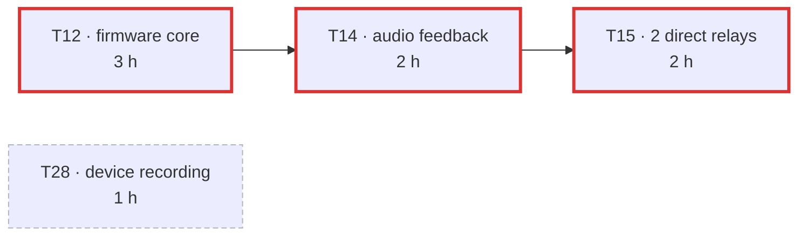

# Tasks — 003 Can Act (Milestone 3, XIAO-only)

**Scope (owner decisions 2026-11-21):** XIAO only. The companion ESP32-S3 SuperMini stack and
the per-command rollout live in **spec 006-can-act-full**; the Orange Pi runtime and cross-target parity are withdrawn (owner, 2026-11-26). Historical wording:
parity live in **spec 005** (final phase). This milestone drives **2 relay channels directly
from the XIAO** (LM, LB) for the minimal trained command set (`la`, `lb`).

**Staged bring-up**: console-only (T12) → audio feedback (T14) → 2 direct relays (T15).
The device-mic recording pass (T28) runs once the hardware is live and is off the critical path.

## Requirement coverage

| Requirement | Tasks |
|---|---|
| FR-001, FR-002, FR-004, FR-005, FR-006, FR-007 | T12 |
| FR-003, FR-008 | T12 |
| FR-009, FR-017, NFR-009 | T15 |
| FR-018, FR-019, FR-037, NFR-010 | T14 |
| FR-038 *(moved to spec 006)* | — (spec 006) |
| NFR-001, NFR-002 | T12 |
| NFR-008 | T12 |
| US-001 | T12, T14, T15 |
| US-007 | T14 |
| US-002 | T28 |
| US-004 *(moved to spec 005)* | — (spec 005) |

This spec **is** Milestone 3 (can act) — see [.ai/sdd/PLAN.md](../../PLAN.md). Depends on spec
001 (MFCC library) and spec 002 (model artifacts + T11 spike outcome). The recognized phrase set
equals the **trained subset** (`wake`, `noise`, `la`, `lb` — spec 002 TD-012); it grows only in
spec 006's rollout cycles.

## Staging

| Stage | Tasks | Exit |
|---|---|---|
| A — Deploy minimal | T12, T14 | US-001 AC1–AC3 pass on the XIAO, events logged, both clips audible; **no actuation** |
| B — Relays minimal | T15 | `la`/`lb` actuate LM + LB per the contract; all channels OFF at boot |

## Implementation readiness check

- [x] `.status` reads `requirements:approved` ✅ (owner-approved 2026-11-21)
- [x] `.status` reads `design:approved` ✅ (owner-approved 2026-11-21)
- [x] `.status` reads `tasks:approved` ✅ (owner-approved 2026-11-21) — **gates all implementation work**
- [x] **Q-011 resolved (fixed-time wipers, owner decision 2026-11-19)**
- [x] **Q-014 resolved (amp on VBUS 5 V, owner decision 2026-11-21)**
- [ ] Specs 001/002 delivered: MFCC library, `model_int8.tflite`, `labels.json`, thresholds
- [x] **XIAO audio output validated (spike `devices/esp32/spike_audio`, 2026-11-20)** — MAX98357A
      + speaker play a flash-streamed clip over I2S on D2/D3/D4 (GPIO3/4/5)
- [ ] Hardware present: XIAO + Sense expansion (PDM mic), MAX98357A + speaker,
      2-channel relay sub-board + external 5 V

Implementation must be executed in dependency order; each task is verified by its own acceptance
criteria before the next begins.

## Hardware validation evidence

Spikes prove a mechanism; they **mark no task complete** (see the 002 T11 rule).

| Spike | Date | Result | De-risks |
|---|---|---|---|
| [`devices/esp32/spike_audio`](../../../devices/esp32/spike_audio/) | 2026-11-20 | Spanish-TTS clip streamed from flash to the MAX98357A over I2S (D2/D3/D4 = GPIO3/4/5, GAIN/SD floating); static ≤ 4 KB chunks | T14 (playback), TD-011 |
| [`devices/esp32/power_probe`](../../../devices/esp32/power_probe/) | 2026-11-20 | D10 (GPIO9) at 3.3 V powers the amp for a bench test; Q-014 resolved to VBUS 5 V | amp power source |

## Critical path (within this spec)

**Critical path: T12 → T14 → T15 (3 + 2 + 2 = 7 h).** T28 (XIAO device-mic recording, US-002)
is off the path — it runs once the hardware is live.

## Tasks

### Stage A — Deploy minimal

### T12 — Firmware core — console-only simulation mode (3 h)
- Covers: FR-001…FR-008, NFR-001, NFR-002, NFR-008. Deps: spec 001 T6, spec 002 T9 + T11.
  Priority: Must.
- **Console-only**: the firmware implements the audio → event path with **serial output only** —
  PDM capture (2 s int16 ring, 500 ms hop, Sense-expansion mic), C MFCC build (100 × 13), TFLM
  interpreter + AllOpsResolver loading `model_int8.tflite`, WAKE_LISTEN ⇄ CONFIRMING ⇄ LISTENING
  state machine (design table), Target Event Contract lines (`EVT WAKE/CMD/TIMEOUT/ERROR`),
  `DBG pred=` lines, static buffers only (no dynamic allocation in the inference loop). **No
  audio output, no relays — every decision is judged from the USB console.** Excludes feedback
  (T14) and outputs (T15).
- Checklist: PDM capture (2 s ring, 500 ms hop), C MFCC build, TFLM interpreter + AllOpsResolver,
  state machine (design table), event contract serial lines, `DBG pred=` lines, static buffers,
  `devices/esp32/ultron_voice/config.h` (thresholds + registry injected at build).
- Likely files: `devices/esp32/ultron_voice/ultron_voice.ino`,
  `devices/esp32/ultron_voice/dsp/*`, `devices/esp32/ultron_voice/config.h`.
- Verify: US-001 AC1–AC3 executed live against the device (event log captured — wake, command and
  timeout visible as `EVT` lines); single-window inference ≤ 400 ms logged (NFR-001); serial emits
  contract lines only; arena + RAM stats within the design Memory budget (inference path
  ≤ 240 KB, NFR-002).
- Status (2026-11-21): implementation landed — `docs/firmware.md`, issue #37.
  - [x] Build: `arduino-cli compile` clean for `esp32:esp32:XIAO_ESP32S3` (606 KB flash,
        169 560 B static RAM).
  - [x] Host verification: state machine (FR-001…FR-008, FR-019, FR-037, Q-005) and the exact
        contract lines in `tests/test_esp32_state_machine.py`; firmware↔host feature parity
        (byte-identical int8 tensor) in `tests/test_esp32_features.py`; generated-config guards in
        `tests/test_esp32_config.py`.
  - [ ] On-device Verify line — **open**, two independent blockers: the shared XIAO is hung
        (needs a physical reset) and spec 002's trained artifact is not reproducible on this
        machine, so the firmware currently embeds a clearly-labelled PLACEHOLDER model. US-001
        AC1 is therefore not claimed.

### T14 — Audio feedback: "Escuchando" + "comando" (2 h)
- Covers: FR-018, FR-019, FR-037, NFR-010, US-007. Deps: T12. Priority: Must.
- Checklist: render + commit `assets/escuchando.wav` (Spanish TTS, 16 k/16-bit/mono, ≤ 500 ms,
  silence-trimmed) and `assets/comando.wav` (Spanish TTS word or short tone, ≤ 300 ms); reuse the
  **hardware-validated I2S path** from `spike_audio` (D2/D3/D4, GAIN/SD floating, amp VIN on
  VBUS 5 V; static ≤ 4 KB chunks); wire it into the `CONFIRMING` state and the playback-overlap
  window discard (design, TD-011); `SPK_INIT_FAILED` fail-fast; `DBG play=` lines; volume notes.
- Likely files: `assets/escuchando.wav`, `assets/comando.wav`,
  `devices/esp32/ultron_voice/feedback.{h,cpp}`, `docs/feedback.md`.
- Verify: "hey ultron" → `WAKE` event → Escuchando audible ≤ 200 ms later and ends ≤ 500 ms
  after start; `CMD` → comando audible ≤ 200 ms later and ≤ 300 ms; a command spoken right
  after the clip is accepted (window started at clip end); below-threshold audio never plays
  anything; missing output device fails boot with `SPK_INIT_FAILED`.

### Stage B — Relays minimal (2 channels, direct on XIAO)

### T15 — Output controller: 2 relay channels on XIAO spare pins (2 h)
- Covers: FR-009, FR-017, NFR-009. Deps: T12, spec 001 T3 (registry). Priority: Must.
- Checklist: wire the 2-channel relay sub-board per the design wiring (LM on D5/GPIO6, LB on
  D8/GPIO7; active-LOW inputs with pull-ups to 3V3, coils on external 5 V, common GND); implement
  the steady/luz-hierarchy engine over those channels (`lm` → LM; `lb` → LM + LB; `la` → LB + LM
  with `DBG out=la state=unwired`); boot-safe outputs (NFR-009); `DBG out=` lines. The 9-channel
  companion stack is **out of scope here** (spec 006).
- Likely files: `devices/esp32/ultron_voice/outputs.{h,cpp}`, `devices/esp32/ultron_voice/pins.h`,
  `docs/wiring.md`.
- Verify: `lb` command → LM + LB steady ON per registry; `la` command → LB + LM steady ON
  (unwired LA logged); all channels OFF at boot/reset; CP/parqueo commands are not in the
  trained set yet (they arrive with spec 006's rollout).

### T28 — Device-mic recording pass (US-002) (1 h)
- Covers: US-002 (XIAO clause), NFR-005 (supplementary data). Deps: spec 001 T4 (recorder
  utilities, complete), hardware (XIAO + Sense mic + microSD). Priority: Must; **off the
  critical path**.
- Checklist: flash `wav_recorder` on the XIAO (`rec {label}` → 5 s WAV on SD, DONE response);
  ingest + validate the device WAVs (`ultron dataset ingest` + `ultron dataset validate`); record
  at least one session per trained label for a later retrain; document the session in
  `docs/recording.md`.
- Likely files: `devices/esp32/wav_recorder/wav_recorder.ino`, `docs/recording.md`.
- Verify: device-recorded WAVs pass `ultron dataset validate` (US-002 AC3); the XIAO writes
  phrase-labeled WAVs (US-002 AC1); MFCC parity is green on features from real recordings; clips
  are tagged with their mic source. *(The Pi recorder half of US-002 was withdrawn with the Pi target, 2026-11-26.)*

## Traceability note

Every task maps to requirements in the coverage table; any FR without a task is a spec gap —
stop and update the spec (never silently implement).
