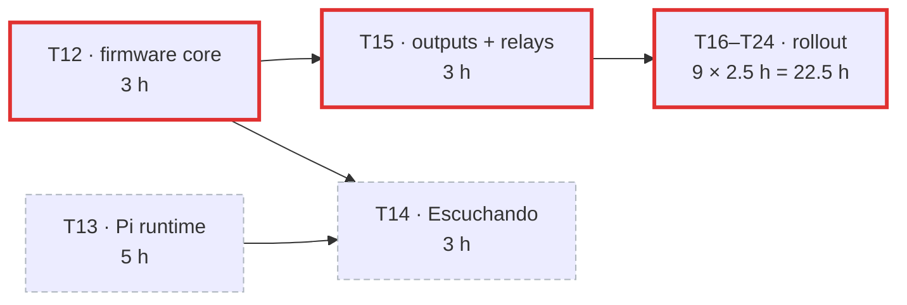

# Tasks — 003 Can Act (Milestone 3)

## Requirement coverage

| Requirement | Tasks |
|---|---|
| FR-001, FR-002, FR-004, FR-005, FR-006, FR-007 | T12, T13 |
| FR-003, FR-008 | T12, T13 |
| FR-009, FR-017, NFR-009 | T15, T13 |
| FR-018, FR-019, NFR-010 | T14 |
| FR-013, FR-032 (spec 002 — retrain/subset clauses exercised by rollout) | T16–T24 |
| NFR-001, NFR-002 | T12, T13 |
| NFR-008 | T12, T13 |
| US-001 | T12, T15, T13 |
| US-004 | T12, T13 |
| US-007 | T14 |

This spec **is** Milestone 3 (can act) — see [.ai/sdd/PLAN.md](../../PLAN.md). Depends on spec
001 (MFCC library) and spec 002 (model artifacts + T11 spike outcome). Work is **staged**
(rollout phases P3–P5+ — see [PLAN.md](../../PLAN.md)): Stage A deploys the minimal model with
events only, Stage B wires the relays for that minimal set, Stage C adds the remaining commands
one rollout cycle at a time. The recognized phrase set equals the **trained subset**
(FR-013; FR-032, spec 002) until Stage C completes.

## Staging (rollout phases P3–P5+)

| Stage | Phase | Tasks | Exit |
|---|---|---|---|
| A — Deploy minimal | P3 | T12, T13 (runtime), T14 | US-001 AC1–AC3 pass on both devices, events logged, **no actuation wiring** |
| B — Relays minimal | P4 | T15, T13 (outputs) | minimal model (`la`, `lb`) actuates its registry channels on both devices |
| C — Rollout, one command per cycle | P5+ | T16–T24 | each new label recognized end-to-end (events + actuation) on both devices |

The minimal model is the 4-class artifact from spec 002 (`wake`, `noise`, `la`, `lb`, TD-012);
channels per registry: `la` → `la`+`lb`+`lm`, `lb` → `lb`.

## Implementation readiness check

- [ ] `.status` reads `requirements:approved` (currently `requirements:draft`)
- [ ] `.status` reads `design:approved`
- [ ] `.status` reads `tasks:approved` — **gates all implementation work**
- [ ] **Q-011 (wiper stop behavior) resolved — the only open question in the system**
- [ ] Specs 001/002 delivered: MFCC library, `model_int8.tflite` / `model_fp16.tflite`,
      `labels.json`, thresholds
- [ ] Hardware present: relays, MAX98357A + speaker (XIAO), USB audio dongle + speaker (Pi)

Implementation must be executed in dependency order; each task is verified by its own acceptance
criteria before the next begins.

## Critical path (within this spec)

Only spec-003 tasks are shown. Entry dependencies: MFCC library (001 T6), model artifacts
(002 T9), spike outcome (002 T11), registry (001 T3), and the 002 CLIs (T7–T10).

**Critical path: T12 → T15 → T16 … T24 (3 + 3 + 22.5 = 28.5 h).** T13 (5 h) and T14 (3 h) run
in parallel. If Stage A exit (T14) is enforced before Stage B starts, the path becomes
T13 → T14 → T15 → T16…T24 (≈ 33.5 h).

## Tasks

### Stage A — Deploy minimal (P3)

### T12 — Firmware core (3 h)
- Covers: FR-001…FR-008, NFR-001, NFR-002, NFR-008. Deps: spec 001 T6, spec 002 T9 + T11.
  Priority: Must.
- Checklist: PDM capture (2 s ring, 500 ms hop), C MFCC build, TFLM interpreter + AllOpsResolver,
  state machine (design table), event contract serial lines, `DBG pred=` lines, static buffers,
  `devices/esp32/ultron_voice/config.h` (thresholds + registry injected at build).
- Likely files: `devices/esp32/ultron_voice/ultron_voice.ino`,
  `devices/esp32/ultron_voice/dsp/*`, `devices/esp32/ultron_voice/config.h`.
- Verify: US-001 AC1–AC3 executed live against the device (event log captured); single-window
  inference ≤ 400 ms logged; serial emits contract lines only.

### T13 — Orange Pi runtime + outputs (5 h)
- Covers: FR-001…FR-009, FR-015 (per-class thresholds applied), FR-017, NFR-001, NFR-008,
  NFR-009. Deps: spec 001 T6, spec 002 T9. Priority: Must.
- Checklist: `devices/orangepi/ultron_pi.py` — sounddevice capture (16 k/16-bit), ctypes MFCC
  binding, tflite_runtime interpreter (float16/int8), same state machine semantics, JSON event
  lines to stdout, fail-fast mic listing (Q-003 rule, spec 001); output controller via libgpiod
  driving the 3.3 V relay board — same behavior engines as T15 (divergence between targets is a
  bug); systemd user-service snippet in docs.
- Likely files: `devices/orangepi/ultron_pi.py`, `devices/orangepi/outputs.py`,
  `devices/orangepi/Makefile` (builds `dsp` .so), `docs/pi.md`.
- Verify: same US-001 AC1–AC3 script passes on the Pi; inference ≤ 200 ms logged; event JSON
  validates against contract.

### T14 — Wake feedback: "Escuchando" on both targets (3 h)
- Covers: FR-018, FR-019, NFR-010, US-007. Deps: T12 (XIAO core), T13 (Pi runtime). Priority:
  Must.
- Checklist: render + commit `assets/escuchando.wav` (Spanish TTS, 16 k/16-bit/mono, ≤ 500 ms,
  silence-trimmed); XIAO I2S output to MAX98357A + speaker with the `CONFIRMING` state and
  playback-overlap window discard (design, TD-011); Pi playback via `sounddevice` through the USB
  dongle; identical trigger/timing/fail-fast (`SPK_INIT_FAILED`) semantics on both targets;
  `DBG play=` lines; wiring + volume notes.
- Likely files: `assets/escuchando.wav`, `devices/esp32/ultron_voice/feedback.{h,cpp}`,
  `devices/orangepi/feedback.py`, `docs/feedback.md`.
- Verify: on both devices — "hey ultron" → `WAKE` event → clip audible ≤ 200 ms later and ends
  ≤ 500 ms after start; a command spoken right after the clip is accepted (window started at
  clip end); below-threshold audio never plays anything; missing output device fails boot with
  `SPK_INIT_FAILED`.

### Stage B — Relays minimal (P4)

### T15 — Firmware output controller + relays (3 h)
- Covers: FR-009, FR-017, NFR-009. Deps: T12, spec 001 T3 (registry). Priority: Must.
- Checklist: 9-channel GPIO layer, behavior engines (`steady` / `blink_45s` /
  `blink_until_cancel` / `cancel` / `motor` / `pulse_2s` / `pulse_05s`), luz hierarchy, GD/GI-vs-P
  priority rules, 50 ms non-blocking tick, boot-safe outputs, `DBG out=` lines, pin allocation
  documented (PCF8574 fallback per TD-009).
- Likely files: `devices/esp32/ultron_voice/outputs.{h,cpp}`, `devices/esp32/ultron_voice/pins.h`.
- Verify: scripted commands produce contract-conformant channel timing (blink 1 s/1 s × 45 s,
  A = 2 s ±50 ms, CC = 0.5 s ±50 ms, CP stops parqueo < 200 ms); all channels OFF at boot.

(The Pi output-controller half of T13 completes Stage B — same behavior engines as T15;
divergence between targets is a bug.)

### Stage C — Rollout, one command per cycle (P5+)

### T16–T24 — Rollout cycles, one per remaining command (2–3 h each)
Each task = one record → train → validate → export → redeploy cycle for a single command
(FR-013 retrain clause; FR-032, spec 002; TD-012). Shared procedure, every task in order:

1. `ultron record` session for the new label + fresh `wake` + `noise` takes; `ultron dataset
   validate` green (FR-023–FR-025, spec 001).
2. `ultron features && ultron train run && ultron train sweep` — fresh hold-out ≥ NFR-003;
   `model/thresholds.json` regenerated (trained commands only).
3. `ultron export tflite` — parity ≥ 99% or fail; `ultron infer files` spot-check on **both**
   artifacts (FR-034, spec 002).
4. Redeploy the identical flatbuffer to XIAO + Pi (AGENTS.md rule 5); verify the new label
   end-to-end and that all previously-rolled-out labels still pass.
5. PR description carries NFR-006 metadata (per-label counts, seed, pinned versions).

| Task | Command | Registry channels / behavior |
|---|---|---|
| T16 | `lm` | `lm`, steady |
| T17 | `gd` | `gd`, blink_45s |
| T18 | `gi` | `gi`, blink_45s |
| T19 | `p` | `gd`+`gi`, blink_until_cancel |
| T20 | `cp` | cancel (no channels) |
| T21 | `lpb` | `lpb`, motor |
| T22 | `lpa` | `lpa`, motor |
| T23 | `a` | `a`, pulse_2s |
| T24 | `cc` | `cc`, pulse_05s |

- Covers (each): FR-013, FR-032 (spec 002), NFR-003, NFR-006. Deps: Stage B complete; spec 002
  T7–T10 CLIs. Priority: Must — one cycle per command, registry order or owner-chosen order.
- Verify (each): the new label is recognized live on both devices (event log) and actuates its
  registry channels; all previously-rolled-out labels still pass; NFR-006 metadata in the PR.

## Traceability note

Every task maps to requirements in the coverage table; any FR without a task is a spec gap —
stop and update the spec (never silently implement).
