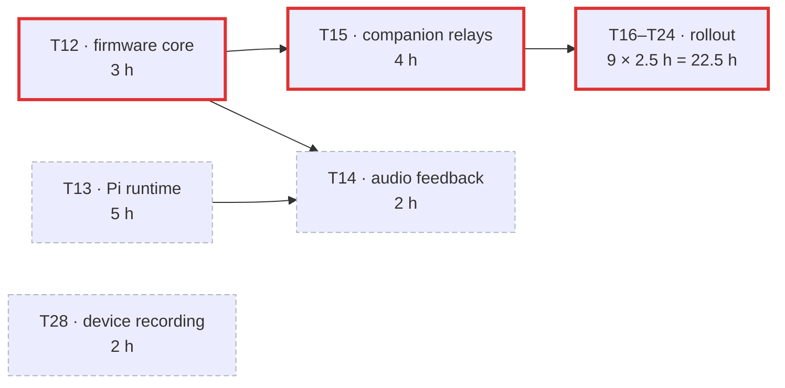

# Tasks — 003 Can Act (Milestone 3)

**Staged bring-up**: the hardware comes up layer by layer — console-only (T12) → audio feedback
(T14) + 2 direct relays (T15 scaffolding) → full companion stack (T15) → Pi parity (T13/T14) →
Stage C rollout (T16–T24). The device-mic recording pass (T28) runs once the hardware is live and
is off the critical path. Each stage is demonstrable on its own before the next begins.

## Requirement coverage

| Requirement | Tasks |
|---|---|
| FR-001, FR-002, FR-004, FR-005, FR-006, FR-007 | T12, T13 |
| FR-003, FR-008 | T12, T13 |
| FR-009, FR-017, NFR-009 | T15, T13 |
| FR-015 (spec 002 — per-class thresholds applied) | T13 |
| FR-018, FR-019, FR-037, NFR-010 | T14 |
| FR-038 | T15 |
| FR-013, FR-032 (spec 002 — retrain/subset clauses exercised by rollout) | T16–T24 |
| NFR-001, NFR-002 | T12, T13 |
| NFR-008 | T12, T13 |
| US-001 | T12, T14, T15, T13 |
| US-004 | T12, T13 |
| US-007 | T14 |
| US-002 | T28 |

This spec **is** Milestone 3 (can act) — see [.ai/sdd/PLAN.md](../../PLAN.md). Depends on spec
001 (MFCC library) and spec 002 (model artifacts + T11 spike outcome). Work is **staged**
(rollout phases P3–P5+ — see [PLAN.md](../../PLAN.md)): Stage A deploys the minimal model with
events + feedback, Stage B wires the relays for that minimal set, Stage C adds the remaining
commands one rollout cycle at a time. The recognized phrase set equals the **trained subset**
(FR-013; FR-032, spec 002) until Stage C completes.

## Staging (rollout phases P3–P5+)

| Stage | Phase | Tasks | Exit |
|---|---|---|---|
| A — Deploy minimal | P3 | T12, T13 (runtime), T14 | US-001 AC1–AC3 pass on both devices, events logged, **no actuation wiring** |
| B — Relays minimal | P4 | T15, T13 (outputs) | minimal model (`la`, `lb`) actuates its registry channels on both devices |
| C — Rollout, one command per cycle | P5+ | T16–T24 | each new label recognized end-to-end (events + actuation) on both devices |

The minimal model is the 4-class artifact from spec 002 (`wake`, `noise`, `la`, `lb`, TD-012);
channels per registry: `la` → `la`+`lb`+`lm`, `lb` → `lb`.

## Implementation readiness check

- [ ] `.status` reads `requirements:approved` (currently `requirements:draft`)
- [ ] `.status` reads `design:approved`
- [ ] `.status` reads `tasks:approved` — **gates all implementation work**
- [x] **Q-011 resolved (fixed-time wipers, owner decision 2026-11-19)**
- [ ] **Q-014 (MAX98357A power source) open — resolve before requirements approval**
- [ ] Specs 001/002 delivered: MFCC library, `model_int8.tflite` / `model_fp16.tflite`,
      `labels.json`, thresholds
- [x] **XIAO audio output validated (spike `devices/esp32/spike_audio`, 2026-11-20)** — MAX98357A
      + speaker play a flash-streamed clip over I2S on D2/D3/D4 (GPIO3/4/5)
- [ ] Hardware present: 9-channel relay board, ESP32-S3 SuperMini + UART jumpers, USB audio
      dongle + speaker (Pi)

Implementation must be executed in dependency order; each task is verified by its own acceptance
criteria before the next begins.

## Hardware validation evidence

Spikes prove a mechanism; they **mark no task complete** (see the 002 T11 rule).

| Spike | Date | Result | De-risks |
|---|---|---|---|
| [`devices/esp32/spike_audio`](../../../devices/esp32/spike_audio/) | 2026-11-20 | Spanish-TTS clip streamed from flash to the MAX98357A over I2S (D2/D3/D4 = GPIO3/4/5, GAIN/SD floating); static ≤ 4 KB chunks | T14 (XIAO playback), TD-011 |
| [`devices/esp32/power_probe`](../../../devices/esp32/power_probe/) | open | Drives D10 (GPIO9) at 3.3 V to test powering the amp's VIN from a GPIO | amp power source (Q-014, open) |

## Critical path (within this spec)

Only spec-003 tasks are shown. Entry dependencies: MFCC library (001 T6), model artifacts
(002 T9), spike outcome (002 T11), registry (001 T3), and the 002 CLIs (T7–T10).

**Critical path: T12 → T15 → T16 … T24 (3 + 4 + 22.5 = 29.5 h).** T13 (5 h) and T14 (2 h) run
in parallel. If Stage A exit (T14) is enforced before Stage B starts, the path becomes
T13 → T14 → T15 → T16…T24 (≈ 33.5 h). T28 (device-mic recording pass, US-002) is off the path —
it runs once the hardware is live and feeds later rollout retrains.

## Tasks

### Stage A — Deploy minimal (P3)

### T12 — Firmware core — console-only simulation mode (3 h)
- Covers: FR-001…FR-008, NFR-001, NFR-002, NFR-008. Deps: spec 001 T6, spec 002 T9 + T11.
  Priority: Must.
- **Console-only**: the firmware implements the audio → event path with **serial output only** —
  PDM capture (2 s int16 ring, 500 ms hop), C MFCC build (100 × 13), TFLM interpreter +
  AllOpsResolver loading `model_int8.tflite`, WAKE_LISTEN ⇄ CONFIRMING ⇄ LISTENING state machine
  (design table), Target Event Contract lines (`EVT WAKE/CMD/TIMEOUT/ERROR`), `DBG pred=` lines,
  static buffers only (no dynamic allocation in the inference loop). **No audio output, no relays
  — every decision is judged from the USB console** (the board simulates the complete system on
  serial). Excludes feedback (T14) and outputs (T15).
- Checklist: PDM capture (2 s ring, 500 ms hop), C MFCC build, TFLM interpreter + AllOpsResolver,
  state machine (design table), event contract serial lines, `DBG pred=` lines, static buffers,
  `devices/esp32/ultron_voice/config.h` (thresholds + registry injected at build).
- Likely files: `devices/esp32/ultron_voice/ultron_voice.ino`,
  `devices/esp32/ultron_voice/dsp/*`, `devices/esp32/ultron_voice/config.h`.
- Verify: US-001 AC1–AC3 executed live against the device (event log captured — wake, command and
  timeout visible as `EVT` lines); single-window inference ≤ 400 ms logged (NFR-001); serial emits
  contract lines only; arena + RAM stats within the design Memory budget (inference path
  ≤ 240 KB, NFR-002).

### T13 — Orange Pi runtime + outputs (5 h)
- Covers: FR-001…FR-009, FR-015 (per-class thresholds applied), FR-017, NFR-001, NFR-008,
  NFR-009. Deps: spec 001 T6, spec 002 T9 + T11. Priority: Must.
- Checklist: `devices/orangepi/ultron_pi.py` — sounddevice capture (16 k/16-bit), ctypes MFCC
  binding, tflite_runtime interpreter (float16/int8), same state machine semantics, JSON event
  lines to stdout, fail-fast mic listing (Q-003 rule, spec 001); output controller via libgpiod
  driving the 3.3 V relay board — same behavior engines as T15 (divergence between targets is a
  bug); systemd user-service snippet in docs.
- Likely files: `devices/orangepi/ultron_pi.py`, `devices/orangepi/outputs.py`,
  `devices/orangepi/Makefile` (builds `dsp` .so), `docs/pi.md`.
- Verify: the same US-001 AC1–AC3 script passes on the Pi; inference ≤ 200 ms logged (NFR-001);
  event JSON validates against the contract; output-timing parity with T15's scripted-command
  checks; both targets load the **identical** flatbuffer (SHA-256 of `model_int8.tflite` matches
  on XIAO and Pi — US-004 AC1).

### T14 — Audio feedback: "Escuchando" + "comando" on both targets (2 h)
- Covers: FR-018, FR-019, FR-037, NFR-010, US-007. Deps: T12 (XIAO core), T13 (Pi runtime).
  Priority: Must.
- Checklist: render + commit `assets/escuchando.wav` (Spanish TTS, 16 k/16-bit/mono, ≤ 500 ms,
  silence-trimmed) and `assets/comando.wav` (Spanish TTS word or short tone, ≤ 300 ms); reuse the
  **hardware-validated I2S path** from `spike_audio` (D2/D3/D4, GAIN/SD floating; static ≤ 4 KB
  chunks, adapt mono assets to the slot layout); wire it into the `CONFIRMING` state and the
  playback-overlap window discard (design, TD-011); Pi playback via `sounddevice` through the USB
  dongle; identical trigger/timing/fail-fast (`SPK_INIT_FAILED`) semantics on both targets;
  `DBG play=` lines; wiring + volume notes. The 1.5 h I2S bring-up is retired — effort goes to
  clip production, state integration and cross-target parity (feedback timing/semantics vs
  recorded logs, parity table).
- Likely files: `assets/escuchando.wav`, `assets/comando.wav`,
  `devices/esp32/ultron_voice/feedback.{h,cpp}`, `devices/orangepi/feedback.py`,
  `docs/feedback.md`.
- Verify: on both devices — "hey ultron" → `WAKE` event → Escuchando audible ≤ 200 ms later and
  ends ≤ 500 ms after start; `CMD` → comando audible ≤ 200 ms later and ≤ 300 ms; a command
  spoken right after the clip is accepted (window started at clip end); below-threshold audio
  never plays anything; missing output device fails boot with `SPK_INIT_FAILED`; the XIAO-vs-Pi
  parity table is within the FR-037/NFR-010 tolerances.

### Stage B — Relays minimal (P4)

### T15 — Output controller + relays: companion SuperMini (4 h)
- Covers: FR-009, FR-017, FR-038, NFR-009. Deps: T12, spec 001 T3 (registry). Priority: Must.
- Checklist: wire the XIAO ↔ ESP32-S3 SuperMini UART per the design Wiring schema — XIAO D8
  (GPIO7) = TX → SuperMini GPIO44 (RX), XIAO D9 (GPIO8) = RX ← SuperMini GPIO43 (TX); SuperMini
  firmware parses the same `EVT` lines on UART (115200-8N1) and runs **all** behavior engines
  (`steady` / `blink_45s` / `blink_until_cancel` / `cancel` / `motor_45s` / `pulse_2s` /
  `pulse_05s`) over **9 relays on GPIO1…GPIO10** (non-strapping pins, pull-ups for active-LOW
  inputs), 50 ms non-blocking tick, boot-safe outputs (NFR-009), `DBG out=` lines on its own USB
  serial (pin map per TD-012; PCF8574 fallback per TD-009); XIAO forwards `WAKE`/`CMD` events over
  UART and logs `DBG uart=idle` when the link is absent (FR-038); **bring-up scaffolding**: ≤ 2
  channels (LM, exercising `steady`, and GD, exercising `blink_45s`) wired directly to the XIAO on
  IN1 → D5 (GPIO6) and IN2 → D6 (GPIO43), decommissioned once the companion link is verified;
  **scaffold removal (end of T15):** remove the D5/D6 scaffold and settle the companion UART link
  on D8/D9 (GPIO7/GPIO8) — never D6/D7 (GPIO43/GPIO44 are the U0TXD/U0RXD console pads).
- Likely files: `devices/esp32/supermini_controller/supermini_controller.ino`,
  `devices/esp32/ultron_voice/uart_forward.{h,cpp}`,
  `devices/esp32/ultron_voice/outputs_scaffold.{h,cpp}` (temporary — deleted at T15 completion),
  `devices/esp32/relay_probe/relay_probe.ino`, `docs/wiring.md`.
- Verify: scripted commands over the UART link produce contract-conformant channel timing —
  blink 1 s on / 1 s off × 45 s, A = 2 s ±50 ms, CC = 0.5 s ±50 ms, CP stops parqueo < 200 ms,
  wiper window = 45 s — all channels OFF at boot; the XIAO's voice + feedback behavior is
  unchanged with the companion attached or absent (FR-038, NFR-009); output-timing parity with the
  Pi.

(The Pi output-controller half of T13 completes Stage B — same behavior engines as T15;
divergence between targets is a bug.)

### Stage C — Rollout, one command per cycle (P5+)

### T16–T24 — Rollout cycles, one per remaining command (2–3 h each)
Each task = one record → train → validate → export → redeploy cycle for a single command
(FR-013 retrain clause; FR-032, spec 002; TD-012).

- Covers (each): FR-013, FR-032 (spec 002), NFR-003, NFR-006. Deps: Stage B complete; spec 002
  T7–T10 CLIs. Priority: Must — one cycle per command, registry order or owner-chosen order.
- Checklist (shared, every task in order):
  1. `ultron record` session for the new label + fresh `wake` + `noise` takes; `ultron dataset
     validate` green (FR-023–FR-025, spec 001).
  2. `ultron features && ultron train run && ultron train sweep` — fresh hold-out ≥ NFR-003;
     `model/thresholds.json` regenerated (trained commands only).
  3. `ultron export tflite` — parity ≥ 99% or fail; `ultron infer files` spot-check on **both**
     artifacts (FR-034, spec 002).
  4. Redeploy the identical flatbuffer to XIAO + Pi (AGENTS.md rule 5); verify the new label
     end-to-end and that all previously-rolled-out labels still pass.
  5. PR description carries NFR-006 metadata (per-label counts, seed, pinned versions).
- Likely files (each): `dataset/originals/<label>/`, `model/thresholds.json`,
  `build/model_int8.tflite`, `build/model_fp16.tflite`, `build/labels.json`,
  `devices/esp32/ultron_voice/config.h` (registry + thresholds rebuilt).

| Task | Command | Registry channels / behavior |
|---|---|---|
| T16 | `lm` | `lm`, steady |
| T17 | `gd` | `gd`, blink_45s |
| T18 | `gi` | `gi`, blink_45s |
| T19 | `p` | `gd`+`gi`, blink_until_cancel |
| T20 | `cp` | cancel (no channels) |
| T21 | `lpb` | `lpb`, motor_45s |
| T22 | `lpa` | `lpa`, motor_45s |
| T23 | `a` | `a`, pulse_2s |
| T24 | `cc` | `cc`, pulse_05s |

- Verify (each): the new label is recognized live on both devices (event log) and actuates its
  registry channels; all previously-rolled-out labels still pass; NFR-006 metadata in the PR.

### T28 — Device-mic recording pass (US-002) (2 h)
- Covers: US-002, NFR-005 (supplementary data). Deps: spec 001 T4 (recorder utilities, complete),
  hardware (XIAO + Pi + Pi USB mic). Priority: Must; **off the critical path**.
- Checklist: run the spec 001 recorder utilities on both devices — flash `wav_recorder` on the
  XIAO (`rec {label}` → 5 s WAV on SD, DONE response) and use `record.py` for the Pi microphone;
  ingest + validate the device WAVs (`ultron dataset ingest` + `ultron dataset validate`); record
  at least one session per label for the next retrain cycle (Stage C); document the session in
  `docs/recording.md`.
- Likely files: `devices/esp32/wav_recorder/wav_recorder.ino`, `devices/orangepi/record.py`,
  `docs/recording.md`.
- Verify: device-recorded WAVs pass `ultron dataset validate` (US-002 AC3); the XIAO writes
  phrase-labeled WAVs and the Pi captures the same format (US-002 AC1/AC2); MFCC parity is green
  on features from real recordings; clips are tagged with their device mic source.

## Traceability note

Every task maps to requirements in the coverage table; any FR without a task is a spec gap —
stop and update the spec (never silently implement).
