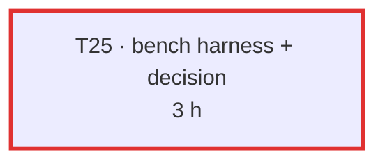

# Tasks — 004 Can Decide (Milestone 4)

## Requirement coverage

| Requirement | Tasks |
|---|---|
| FR-014, NFR-004 | T25 |
| FR-008 / FR-009 / NFR-010 (verification clause) | T25 |
| NFR-001, NFR-002, NFR-008 (bench clauses) | T25 |
| US-005 | T25 |

This spec **is** Milestone 4 (can decide) — see [.ai/sdd/PLAN.md](../../PLAN.md). Depends on
spec 003 (both devices running the loop end-to-end) after Stage C (full phrase set rolled out).

## Implementation readiness check

- [ ] `.status` reads `requirements:approved` (currently `requirements:draft`)
- [ ] `.status` reads `design:approved`
- [ ] `.status` reads `tasks:approved` — **gates all implementation work**
- [ ] Spec 003 **Stage C** complete: both devices pass US-001 AC1–AC3 on the full rolled-out set
      (incl. "Escuchando" feedback)

## Critical path (within this spec)

Single-task spec — the bench is the path. Entry dependency: spec 003 Stage C complete.

**Critical path: T25 (3 h).**

## Tasks

### T25 — Benchmark harness + device decision (3 h)
- Covers: FR-014, NFR-004, US-005. Deps: spec 003 Stage C complete (T12, T13, T15, T16–T24).
  Priority: Must.
- Checklist: `ultron bench run --device xiao|pi` parses event + output logs; latency, confusion
  matrix (incl. luz triple and guiñador pair per Q-002), 30 min false-accept counter, memory
  stats, output timing checks (FR-009 tolerances) + feedback timing (NFR-010); writes
  `docs/bench.md` table; device decision block with justification.
- Likely files: `cli/src/ultron/bench.py`, `docs/bench.md`.
- Verify: bench table populated for both devices from real logs; NFR-004 targets evaluated.

## Traceability note

Every task maps to requirements in the coverage table; any FR without a task is a spec gap —
stop and update the spec (never silently implement).
