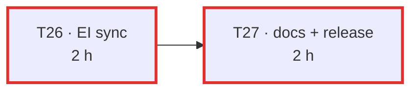

# Tasks — 005 Archived (Milestone 5)

## Requirement coverage

| Requirement | Tasks |
|---|---|
| FR-012, US-006 | T26 |
| NFR-006 | T26, T27 |

This spec **is** Milestone 5 (archived) — see [.ai/sdd/PLAN.md](../../PLAN.md). Depends on spec
001 (dataset + registry), spec 002 (int8 artifact), and spec 003 Stage C (full rolled-out set).

## Implementation readiness check

- [ ] `.status` reads `requirements:approved` (currently `requirements:draft`)
- [ ] `.status` reads `design:approved`
- [ ] `.status` reads `tasks:approved` — **gates all implementation work**
- [ ] Specs 001/002 delivered: dataset, `registry.json`, `model_int8.tflite`
- [ ] Spec 003 Stage C complete (full phrase set rolled out); final artifacts exported

## Critical path (within this spec)

**Critical path: T26 → T27 (2 + 2 = 4 h).** T26 entry deps: spec 001 T3 + spec 002 T9; T27
depends on all milestone specs.

## Tasks

### T26 — Edge Impulse one-way sync (2 h)
- Covers: FR-012, US-006. Deps: spec 001 T3, spec 002 T9. Priority: Should.
- Checklist: `ultron ei sync` (EI API via `.env` key; upload originals with labels + registry
  metadata + current int8 model), dry-run mode, post-sync local checksum comparison, refuses any
  download/overwrite of local artifacts.
- Likely files: `cli/src/ultron/ei_sync.py`, `tests/test_ei_sync.py` (mocked API).
- Verify: dry-run prints target list; real run uploads to EI project; local checksums identical.

### T27 — Docs + release bookkeeping (2 h)
- Covers: NFR-006, US-005 (doc completeness clause). Deps: all milestone specs. Priority: Should.
- Checklist: README final; `docs/model.md`, `docs/retraining.md`, `docs/troubleshooting.md`;
  CHANGELOG verified as PR-generated (no hand edits); `review.md` written with evidence; bump
  `.status` per phase in every spec.
- Verify: all doc links resolve; every inference-affecting change has a conventional PR title.

## Traceability note

Every task maps to requirements in the coverage table; any FR without a task is a spec gap —
stop and update the spec (never silently implement).
