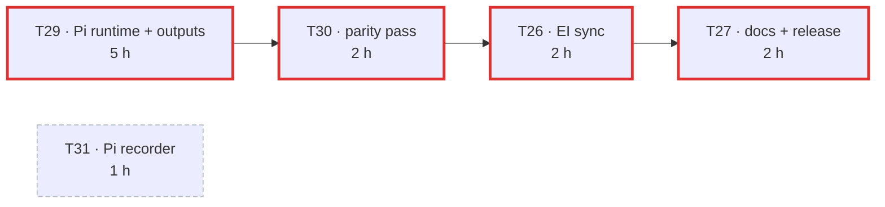

# Tasks — 005 Pi + Archived (Milestone 5, final phase)

## Requirement coverage

| Requirement | Tasks |
|---|---|
| US-004, FR-001…FR-009 (Pi clauses) | T29, T30 |
| FR-018, FR-019, FR-037, NFR-010 (Pi) | T29, T30 |
| US-002 (Pi recorder clause) | T31 |
| FR-012, US-006 | T26 |
| NFR-006 | T26, T27 |

This spec **is** Milestone 5 (final phase) — see [.ai/sdd/PLAN.md](../../PLAN.md). Depends on spec
001 (dataset + registry), spec 002 (exported artifacts), spec 003 (XIAO runtime + committed audio
assets), and spec 006 (full rolled-out phrase set).

## Implementation readiness check

- [ ] `.status` reads `requirements:approved` (currently `requirements:draft`)
- [ ] `.status` reads `design:approved`
- [ ] `.status` reads `tasks:approved` — **gates all implementation work**
- [ ] Specs 001/002 delivered: dataset, `registry.json`, `model_int8.tflite`
- [ ] Spec 003 delivered: XIAO runtime + committed `escuchando`/`comando` assets
- [ ] Spec 006 rollout complete (full phrase set); final artifacts exported
- [ ] Pi hardware present: Orange Pi Zero 2W, USB mic, USB audio dongle + powered speaker,
      3.3 V relay board

## Critical path (within this spec)

**Critical path: T29 → T30 → T26 → T27 (5 + 2 + 2 + 2 = 11 h).** T31 (Pi recorder, US-002 Pi
clause) is off the path.

## Tasks

### T29 — Orange Pi runtime + outputs (5 h)
- **Specific** — `devices/orangepi/ultron_pi.py`: sounddevice capture (16 k/16-bit), ctypes MFCC
  binding (same C library), tflite_runtime interpreter (float16/int8), same state machine
  semantics, JSON event lines to stdout, fail-fast mic listing; output controller via libgpiod on
  the 3.3 V relay board (same behavior engines — full set from spec 006); playback of the shared
  `escuchando`/`comando` assets via the USB audio dongle.
- **Measurable** — Verify: US-001 AC1–AC3 script passes on the Pi; inference ≤ 200 ms logged;
  event JSON validates against the contract; both devices load the identical flatbuffer
  (SHA-256 match — US-004 AC1).
- **Achievable** — Deps: spec 001 T6 (MFCC), spec 002 T9 (artifacts), spec 003 (state-machine
  semantics + assets). Debian 12 ships libgpiod; tflite_runtime has an aarch64 wheel (full TF is
  the documented fallback, TD-005).
- **Relevant** — Covers the Pi clauses of FR-001…FR-009, FR-015, FR-017, FR-018/019/037,
  NFR-001/008/009/010; delivers US-004's device half.
- **Time-bound** — 5 h: 1.5 h capture + DSP, 1.5 h inference + state machine, 1 h outputs,
  1 h events + docs.
- Likely files: `devices/orangepi/ultron_pi.py`, `devices/orangepi/outputs.py`,
  `devices/orangepi/Makefile` (builds `dsp` .so), `docs/pi.md`.

### T30 — Cross-target parity pass (2 h)
- **Specific** — scripted comparison of XIAO (spec 003 runtime) vs Pi (T29) on the same audio:
  event types/ordering, feedback timing, actuation timing; parity table in `docs/feedback.md`
  and `docs/bench.md` inputs.
- **Measurable** — Verify: parity table shows both targets within FR-009/NFR-010/FR-037
  tolerances; any divergence is filed as a bug (AGENTS rule 5), not accepted as a platform quirk.
- **Achievable** — Deps: T29, spec 003 runtime; identical assets and flatbuffer.
- **Relevant** — US-004 AC2, NFR-010, AGENTS rule 5.
- **Time-bound** — 2 h: 1 h harness + runs, 1 h parity table + fixes triage.
- Likely files: `docs/pariity.md` (subsumed by `docs/feedback.md`), `tools/src/...` (bench parser
  reuse from spec 004).

### T31 — Pi recorder (US-002 Pi clause) (1 h)
- **Specific** — `devices/orangepi/record.py` (sounddevice, 16 k/16-bit/mono, label arg, mic tag
  `pi`); document the session in `docs/recording.md`.
- **Measurable** — Verify: Pi recorder writes a valid WAV (`ultron dataset validate` passes it);
  clips are tagged with the `pi` mic source.
- **Achievable** — Deps: T29 (Pi environment), spec 001 `dataset validate`, USB mic present.
- **Relevant** — US-002 Pi clause; supplies Pi-mic recordings for future retrains.
- **Time-bound** — 1 h: script + validation + docs.
- Likely files: `devices/orangepi/record.py`, `docs/recording.md`.

### T26 — Edge Impulse one-way sync (2 h)
- Covers: FR-012, US-006. Deps: spec 001 T3, spec 002 T9. Priority: Should.
- Checklist: `ultron ei sync` (EI API via `.env` key; upload originals with labels + registry
  metadata + current int8 model), dry-run mode, post-sync local checksum comparison, refuses any
  download/overwrite of local artifacts.
- Likely files: `cli/src/ultron/ei_sync.py`, `tests/test_ei_sync.py` (mocked API).
- Verify: dry-run prints target list; real run uploads to EI project; local checksums identical.

### T27 — Docs + release bookkeeping (2 h)
- Covers: NFR-006, US-005 (doc completeness clause). Deps: all milestone specs. Priority: Should.
- Checklist: README final; `docs/model.md`, `docs/retraining.md`, `docs/troubleshooting.md`;
  CHANGELOG verified as PR-generated (no hand edits); `review.md` written with evidence; bump
  `.status` per phase in every spec.
- Verify: all doc links resolve; every inference-affecting change has a conventional PR title.

## Traceability note

Every task maps to requirements in the coverage table; any FR without a task is a spec gap —
stop and update the spec (never silently implement).
